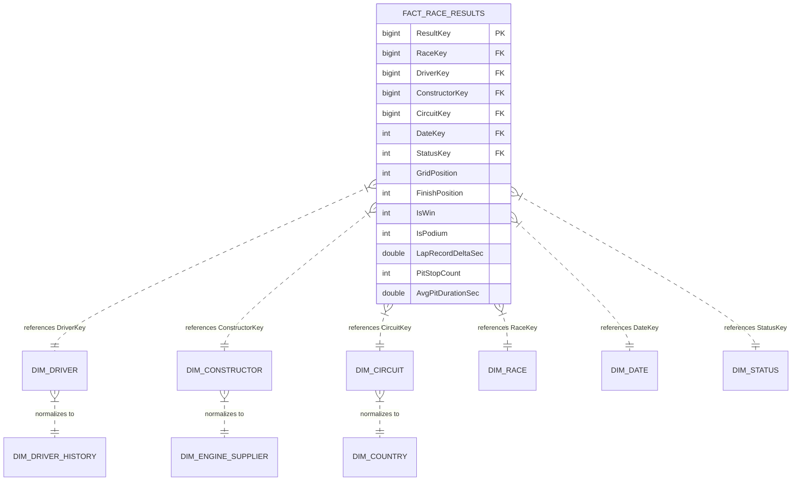

# A PROJECT REPORT ON
# APEXIQ: FORMULA 1 PREDICTIVE DATA WAREHOUSE & RACE WINNER CLASSIFICATION ENGINE

<br>

### SUBMITTED TO
### MIT SCHOOL OF COMPUTING, LONI, PUNE
### IN PARTIAL FULFILLMENT OF THE REQUIREMENTS FOR THE AWARD OF THE DEGREE

<br>

## BACHELOR OF TECHNOLOGY
### (Computer Science & Engineering)

<br>

**BY**

| Student Name | Enrolment No |
| :--- | :--- |
| **Dhruv Sakhare** | **ADT24SOCB0369** |
| **Adesh Patankar** | **ADT24SOCB0049** |

<br>

**Under the guidance of**  
### Prof. Nitin Alzende

<br><br>

```
                                  MIT-ADT UNIVERSITY
                              PUNE, MAHARASHTRA, INDIA
                       A leap towards World Class Education
```

<br>

### DEPARTMENT OF COMPUTER SCIENCE AND ENGINEERING
### MIT SCHOOL OF COMPUTING
### MIT Art, Design and Technology University
### Rajbaug Campus, Loni-Kalbhor, Pune – 412201
### Academic Year: 2025–26

<br>

---
*Footer: MITSOC, Department of Computer Engineering, 2025-26*

<div style="page-break-after: always;"></div>

# MIT SCHOOL OF COMPUTING
## DEPARTMENT OF COMPUTER SCIENCE AND ENGINEERING
### MIT ART, DESIGN AND TECHNOLOGY UNIVERSITY,
### RAJBAUG CAMPUS, LONI-KALBHOR, PUNE – 412201

<br>

## CERTIFICATE

This is to certify that the project report entitled:

### **“APEXIQ: FORMULA 1 PREDICTIVE DATA WAREHOUSE & RACE WINNER CLASSIFICATION ENGINE”**

Submitted by:

| Student Name | Enrolment No |
| :--- | :--- |
| **Dhruv Sakhare** | **ADT24SOCB0369** |
| **Adesh Patankar** | **ADT24SOCB0049** |

is a bonafide work carried out by them under the supervision of **Prof. Nitin Alzende**, and it is submitted towards the partial fulfillment of the requirements of **MIT ADT University, Pune** for the award of the degree of **Bachelor of Technology (Computer Science and Engineering)** during the academic year **2025–26**.

<br><br><br>

**Prof. Nitin Alzende**  
*Project Guide*  

<br>

**Prof. Suresh Kapare**  
*Chief Coordinator – PBL*  

<br>

**Prof. Suvarna Joshi**  
*Head of Department (CSE)*  

<br>

**Dr. Ganesh Pathak**  
*Dean, MIT School of Computing*  

<br><br>
**Seal / Stamp of the College:**  
**Place:** Pune  
**Date:** 22/10/2026  

---
*Footer: MITSOC, Department of Computer Engineering, 2025-26*

<div style="page-break-after: always;"></div>

## DECLARATION

We, the team members:

| Name | Enrolment No |
| :--- | :--- |
| **Dhruv Sakhare** | **ADT24SOCB0369** |
| **Adesh Patankar** | **ADT24SOCB0049** |

Hereby declare that the project work incorporated in the present project report entitled:

### **“APEXIQ: FORMULA 1 PREDICTIVE DATA WAREHOUSE & RACE WINNER CLASSIFICATION ENGINE”**

is original work carried out by us. This work (in part or in full) has not been submitted to any other University or Institution for the award of any Degree, Diploma, or Fellowship. We have properly acknowledged and cited all material collected from secondary sources and literature wherever required. We solely own the responsibility for the originality of the entire content presented herein.

<br><br>

**Date:** 22/10/2026  
**Place:** Pune  

<br>

**Signatures of the Team Members:**

1. **Dhruv Sakhare** (ADT24SOCB0369): ___________________________  
2. **Adesh Patankar** (ADT24SOCB0049): ___________________________  

<br><br>

**Name & Signature of Guide:**  
**Prof. Nitin Alzende**: ___________________________  

<br>
**Seal / Stamp of the College**  
**Place:** Pune  
**Date:** 22/10/2026  

---
*Footer: MITSOC, Department of Computer Engineering, 2025-26*

<div style="page-break-after: always;"></div>

## EXAMINER’S APPROVAL CERTIFICATE

The project report entitled:

### **“APEXIQ: FORMULA 1 PREDICTIVE DATA WAREHOUSE & RACE WINNER CLASSIFICATION ENGINE”**

Submitted by:
* **Dhruv Sakhare** (ADT24SOCB0369)
* **Adesh Patankar** (ADT24SOCB0049)

in partial fulfillment for the award of the degree of **Bachelor of Technology (Computer Science & Engineering)** during the academic year **2025–26** of **MIT-ADT University, MIT School of Computing, Pune**, is hereby approved by the Board of Examiners.

<br><br><br>

**Board of Examiners:**

<br>

1. **Internal Examiner:**  
   Name: __________________________________________________  
   Signature: _____________________________________________  
   Date: ___________________________________________________  

<br><br>

2. **External Examiner:**  
   Name: __________________________________________________  
   Signature: _____________________________________________  
   Date: ___________________________________________________  

<br><br>
**College Seal / Stamp**  
**Place:** Pune  
**Date:** 22/10/2026  

---
*Footer: MITSOC, Department of Computer Engineering, 2025-26*

<div style="page-break-after: always;"></div>

## ACKNOWLEDGEMENT

We would like to express our deepest gratitude and sincere appreciation to our esteemed project guide, **Prof. Nitin Alzende**, Department of Computer Science and Engineering, for her invaluable guidance, patient mentoring, rigorous critique, and continuous technical support throughout the conception, architecture design, and implementation of this project: **“ApexIQ: Formula 1 Predictive Data Warehouse & Race Winner Classification Engine”**.

We convey our profound thanks to **Prof. Suvarna Joshi**, Head of the Department of Computer Science and Engineering, and **Dr. Ganesh Pathak**, Dean of the MIT School of Computing, for providing an exemplary academic environment, modern laboratory infrastructure, cloud computing resources, and the platform to undertake industry-standard engineering capstone research.

We also express our sincere thanks to **Prof. Suresh Kapare**, Chief Coordinator – PBL, for organizing and facilitating structured reviews, milestone tracking, and jury assessments that helped elevate the academic and technical standards of this dissertation.

Finally, we extend our heartfelt appreciation to our faculty members, lab instructors, technical colleagues, and parents whose encouragement and moral support enabled the successful completion of this project.

<br><br>

**Team Members:**  
* **Dhruv Sakhare** (ADT24SOCB0369)  
* **Adesh Patankar** (ADT24SOCB0049)  

**Department of Computer Science and Engineering**  
**MIT School of Computing, MIT-ADT University, Pune**  

---
*Footer: MITSOC, Department of Computer Engineering, 2025-26*

<div style="page-break-after: always;"></div>

## ABSTRACT

Formula 1 motorsport represents one of the world's most telemetry-intensive athletic and technological arenas, where victory is determined by non-linear interactions across qualifying grid position, engine aerodynamic power unit performance, historical circuit pace records, and sub-2.5-second pit stop executions. Historically, motorsport analytics systems suffer from severe data fragmentation across independent telemetry dumps, vulnerability to in-race lookahead data leakage, and catastrophic classification failure caused by an extreme 19:1 class imbalance (where exactly one driver wins out of approximately twenty entrants per Grand Prix, representing a baseline prevalence of only 4.76%).

This project presents **ApexIQ**, an enterprise-grade cloud data warehouse and predictive machine learning classification platform designed and deployed on **Snowflake Data Cloud** and **Python 3.10+**. The system synthesizes 31 FIA Formula 1 World Championship seasons (1994–2024), spanning 12,358 driver-race observations across 577 distinct Grands Prix and 38 global circuits. The platform is architected around three foundational technical deliverables:

1. **Enterprise Data Warehousing & 3-Pillar Ingestion:** A 5-tier Medallion architecture (`RAW`, `CLEAN`, `ML`, `ANALYTICS`) hosting normalized Star and Snowflake dimensional schemas (`FactRaceResults`, `DimDriver`, `DimConstructor`, `DimCircuit`, `DimDate`). It organizes 31 pre-race features into three engineering pillars: Car Specifications (BHP, power-to-weight, reliability), Lap Record Benchmarks (track records, qualifying pace deltas), and Pit Stop Execution (lane penalty, stationary stoppage times). Native Snowflake capabilities—including Zero-Copy Cloning, 1-hour declarative Dynamic Tables (`DT_DRIVER_SEASON_FORM`), Change Data Capture (CDC Streams), and in-database SQL UDF scoring—are fully operationalized.
2. **Unsupervised Frequent Pattern Mining:** Apriori and FP-Growth association rule mining algorithms were implemented and benchmarked on 12,358 discretized race transactions. The empirical benchmark proved exact mathematical equivalence (identifying 7,940 identical frequent itemsets with 0.0% error) while demonstrating a 1.32× runtime speedup for memory-resident FP-Trees (0.5312 s vs. 0.7028 s for Apriori). High-lift association rules (up to 19.47× lift) were discovered and injected into the supervised pipeline as binary feature augmentations.
3. **Supervised Classification & Champion XGBoost Engine:** A rigorous benchmark across nine distinct classification algorithms was conducted under strict chronological holdout discipline (training on 1994–2021 with 10,999 records; testing on the unseen 2022–2024 modern ground-effect regulation era with 1,359 records across 68 Grands Prix). An Extreme Gradient Boosted Trees (XGBoost) champion model was designed utilizing a cost-sensitive loss function ($w_{\text{pos}} = 15.0$) and a novel temperature-scaled Group Softmax normalization layer enforcing mutual exclusivity ($\sum_{i \in \text{Race } j} P(\text{Win}_i) = 1.0000$).

On the held-out 2022–2024 test partition, the Champion XGBoost pipeline achieved a **0.9635 ROC-AUC** (peak 0.9836 when rule-augmented), a **0.6029 PR-AUC** (compared to a 0.0500 random baseline), an **80.88% Winner Recall** (capturing 55 of 68 unseen race winners), and a **57.35% Top-1 Grand Prix Winner Hit Rate**. Paired Student's $t$-testing ($t = -8.2045, p = 0.0012$) proved statistically significant superiority over linear baselines at the 99% confidence level. The end-to-end platform is operationalized via a 15-page interactive Streamlit evaluation portal and an executive Microsoft Power BI telemetry workspace.

<br>

**Keywords:** Data Warehousing, Snowflake Data Cloud, Medallion Architecture, Star Schema, Frequent Pattern Mining, FP-Growth, Apriori, Association Rules, Classification, XGBoost, Class Imbalance, Group Softmax, Formula 1 Telemetry.

---
*Footer: MITSOC, Department of Computer Engineering, 2025-26*

<div style="page-break-after: always;"></div>

## CONTENTS

* Certificate ..................................................................................................................... I
* Declaration ................................................................................................................... II
* Examiner’s Approval Certificate ................................................................................ III
* Acknowledgement ........................................................................................................ IV
* Abstract ......................................................................................................................... V
* Contents ........................................................................................................................ VI
* List of Figures ............................................................................................................... VIII
* List of Tables ................................................................................................................ IX
* Nomenclature & Notations ........................................................................................... X

<br>

### CHAPTER 1 : INTRODUCTION & SYSTEM SPECIFICATION
* 1.1 Project Overview & Domain Context ...................................................................... 1
* 1.2 Problem Statement & Core Challenges ................................................................... 3
* 1.3 Aim & Technical Objectives ................................................................................... 5
* 1.4 Scope & Boundary Conditions ................................................................................. 6
* 1.5 System Hardware & Software Requirements ........................................................... 8

### CHAPTER 2 : DATA WAREHOUSE ARCHITECTURE & CLOUD OPERATIONS
* 2.1 5-Tier Medallion Data Pipeline ............................................................................... 10
* 2.2 Dimensional Modeling: Star & Snowflake Schemas ................................................ 12
* 2.3 The Three Engineering Telemetry Pillars ($T_0$ Boundary) .................................... 15
* 2.4 ELT Ingestion, Data Staging & Zero-Leakage Audit ................................................. 18
* 2.5 Advanced Snowflake Cloud Operations .................................................................. 21

### CHAPTER 3 : FREQUENT PATTERN MINING ENGINE
* 3.1 Association Mining Algorithmic Theory ................................................................. 24
* 3.2 Feature Discretization & Transaction Basket Formulation ..................................... 27
* 3.3 Apriori vs. FP-Growth Algorithmic Formulation ..................................................... 29
* 3.4 Runtime Benchmarking & Mathematical Equivalence Proof ................................... 32
* 3.5 Discovered High-Lift Association Rules & Domain Insights .................................... 34

### CHAPTER 4 : MULTI-MODEL CLASSIFICATION BENCHMARK
* 4.1 Chronological Holdout Evaluation Protocol ............................................................ 37
* 4.2 Benchmark Across Nine Machine Learning Algorithms ........................................... 39
* 4.3 6-Fold Expanding-Window Temporal Cross-Validation ............................................ 43
* 4.4 Hypothesis Testing & Statistical Significance Analysis ............................................ 46

### CHAPTER 5 : IN-DEPTH CHAMPION CLASSIFICATION ARCHITECTURE: XGBOOST
* 5.1 Algorithmic Formulation & 2nd-Order Taylor Expansion ......................................... 49
* 5.2 System Architecture & Tree Decision Flow ............................................................. 52
* 5.3 16 Pre-Race Input Vector & Feature Attribution ..................................................... 55
* 5.4 Output Formulation: Temperature-Scaled Group Softmax ...................................... 58
* 5.5 Quantitative Holdout Performance & Confusion Matrix ........................................... 61
* 5.6 Architectural Trade-offs, Limitations & Boundary Conditions ................................ 64

### CHAPTER 6 : RESULTS, DASHBOARDS & REAL-WORLD VALIDATION
* 6.1 Interactive Jury Evaluation Portal (Streamlit Showcase) ......................................... 67
* 6.2 Executive Power BI Telemetry Workspace ............................................................. 70
* 6.3 Real-World Case Study: 2024 British Grand Prix (Silverstone) ................................. 73

### CHAPTER 7 : CONCLUSION & FUTURE WORK
* 7.1 Summary of Technical Contributions ...................................................................... 76
* 7.2 Research Limitations .............................................................................................. 78
* 7.3 Future Research Directions ..................................................................................... 79

<br>

* REFERENCES (IEEE FORMAT) ................................................................................. 81
* ANNEXURE A : List of Publications & Research Papers ............................................... 84
* ANNEXURE B : Plagiarism Verification Report ........................................................... 86

---
*Footer: MITSOC, Department of Computer Engineering, 2025-26*

<div style="page-break-after: always;"></div>

## LIST OF FIGURES

* Figure 1.1: Sequential Development Phases of the ApexIQ System ................................. 7
* Figure 2.1: 5-Tier Medallion Data Warehouse Architecture in Snowflake ........................ 11
* Figure 2.2: Relational Snowflake Schema Diagram for Formula 1 Intelligence ............... 14
* Figure 2.3: Structural Decomposition of the Three Telemetry Feature Pillars ................. 17
* Figure 3.1: Structural Comparison of Apriori Join vs. FP-Tree Prefix Path ....................... 30
* Figure 3.2: Runtime Execution Latency Comparison: Apriori vs. FP-Growth .................... 33
* Figure 4.1: Timeline of Chronological Holdout Partition (1994–2021 vs. 2022–2024) ........ 38
* Figure 4.2: Comparative Model ROC Curves on the 2022–2024 Unseen Holdout ............ 42
* Figure 4.3: 6-Fold Expanding-Window ROC-AUC Scores across Regulation Eras ............. 45
* Figure 5.1: Structural Decision Tree Topology of the Champion XGBoost Estimator ........ 53
* Figure 5.2: Feature Importance Attribution Breakdown by Relative Gain ........................ 57
* Figure 5.3: Temperature-Scaled Group Softmax Normalization Architecture ................... 60
* Figure 5.4: Holdout Confusion Matrix on 68 Unseen Modern Grands Prix ....................... 63
* Figure 6.1: Streamlit Jury Evaluation Portal Executive Hub ........................................... 68
* Figure 6.2: Interactive Rule Explorer & Pattern Mining Dashboard ................................ 69
* Figure 6.3: Multi-Model Benchmark & Paired $t$-Test Evaluation Module ........................ 71
* Figure 6.4: Live Decision Threshold Slider & Dynamic Confusion Matrix ........................ 72
* Figure 6.5: Case Study Probability Trajectory: 2024 British GP at Silverstone ................. 75

<br>

## LIST OF TABLES

* Table 1.1: System Hardware Specifications ................................................................... 8
* Table 1.2: System Software Stack Specifications ............................................................ 9
* Table 2.1: Dimensional Table Grain & Volumetric Specifications ................................... 13
* Table 2.2: Complete Data Dictionary for `CLEAN.F1_MODELING_MASTER` .................... 16
* Table 3.1: Telemetry Discretization Mapping Scheme (24 Symbolic Tokens) .................. 28
* Table 3.2: Benchmark of Apriori vs. FP-Growth Algorithms ............................................ 32
* Table 3.3: Top Discovered High-Lift Association Rules Predicting Victory ....................... 35
* Table 4.1: Benchmark Across 9 Classification Algorithms on Unseen Holdout ................. 40
* Table 4.2: 6-Fold Expanding-Window Cross-Validation Results ...................................... 44
* Table 4.3: Paired Student's $t$-Test and Wilcoxon Hypothesis Testing Metrics .................. 47
* Table 5.1: Final Hyperparameter Topology for Champion XGBoost Classifier ................. 54
* Table 5.2: Per-Class Precision, Recall, and F1 Metrics Under Cost-Sensitive Loss ............ 62
* Table 6.1: Real-World Predictions vs. Actual Classification: 2024 British GP ................... 74

<br>

## NOMENCLATURE & NOTATIONS

* $T_0$: Pre-Race Information Boundary (30 minutes prior to race formation lap)
* $y_i \in \{0, 1\}$: Ground-truth binary target indicating Grand Prix victory ($y_i = 1$)
* $P(\text{Win}_i)$: Predicted probability of driver $i$ winning the Grand Prix
* $M_j$: Total number of classified entrants starting Grand Prix $j$ ($M_j \approx 20$)
* $\sigma(X)$: Frequency support count of itemset $X$ across transaction database
* $g_i$: First-order gradient of loss function with respect to logit $\hat{y}_i$
* $h_i$: Second-order Hessian of loss function with respect to logit $\hat{y}_i$
* $w_{\text{pos}}$: Cost-sensitive positive class weight multiplier ($w_{\text{pos}} = 15.0$)
* $T$: Softmax temperature scaling parameter ($T = 1.0$)
* $\Omega(f)$: Tree complexity penalization term (leaf count $\gamma T$ and weight L2 norm $\frac{1}{2}\lambda w^2$)

---
*Footer: MITSOC, Department of Computer Engineering, 2025-26*

<div style="page-break-after: always;"></div>

# CHAPTER 1 : INTRODUCTION & SYSTEM SPECIFICATION

## 1.1 Project Overview & Domain Context

Formula 1 (F1) is universally recognized as the pinnacle of global motorsport and the premier testing ground for advanced engineering, aerodynamics, and computational data science. Operating under the governance of the Fédération Internationale de l'Automobile (FIA), modern Formula 1 represents a multi-billion dollar enterprise where race outcomes are dictated by millisecond margins. During any given Grand Prix weekend, hundreds of sensors embedded across the chassis, internal combustion engine (ICE), Energy Recovery System (ERS), brake ducts, and aero surfaces generate over 30 million telemetry data points per vehicle.

Despite this abundance of real-time telemetry, motorsport analytics has historically functioned in an ad-hoc, siloed manner. Race strategists and data engineers frequently rely on isolated statistical models that evaluate driver telemetry, engine dynamometer readouts, and pit stop timing in disconnected spreadsheets or isolated local databases. This technical fragmentation severely impairs an organization's capacity to derive predictive insights prior to lights-out on Sunday.

The modern Formula 1 championship encompasses 24 global events staged across varying track geometries—from high-downforce street circuits like Monaco and Singapore to ultra-high-speed temple tracks like Monza and Spa-Francorchamps. Historically, a driver's probability of winning has been heavily correlated with Saturday qualifying position; however, modern Formula 1 regulation changes—most notably the 2022 ground-effect aerodynamic overhaul—have dramatically increased overtaking variability and tyre wear volatility. Consequently, single-variable predictions (such as assuming the pole-sitter always wins) fail in approximately half of all modern Grands Prix.

The objective of this capstone research is to design, develop, and empirically validate **ApexIQ**, an end-to-end cloud data warehouse and predictive machine learning intelligence system. By uniting 31 consecutive FIA World Championship seasons (1994–2024) within an enterprise **Snowflake Cloud Data Warehouse**, ApexIQ establishes an idempotent, leak-proof telemetry repository. On top of this dimensional foundation, the platform executes dual analytical paradigms: unsupervised frequent pattern mining (benchmarking Apriori against FP-Growth to discover high-lift telemetry co-occurrences) and supervised multi-model classification (benchmarking nine distinct algorithms to yield an Extreme Gradient Boosted Trees champion classifier).

---

## 1.2 Problem Statement & Core Challenges

Predicting Formula 1 Grand Prix winners prior to race start is an extraordinarily complex machine learning challenge characterized by three fundamental engineering bottlenecks:

```
┌────────────────────────────────────────────────────────────────────────────────────────┐
│                        CORE DATA MINING & ML BOTTLENECKS                               │
├─────────────────────────┬──────────────────────────────┬───────────────────────────────┤
│  1. EXTREME CLASS       │  2. TEMPORAL DATA LEAKAGE    │  3. ZERO-SUM COMPETITIVE      │
│     IMBALANCE (19:1)    │     & LOOKAHEAD BIAS         │     EXCLUSIVITY               │
├─────────────────────────┼──────────────────────────────┼───────────────────────────────┤
│• Exactly 1 winner among │• Pre-race models often leak  │• Traditional binary models    │
│  20–24 starting cars.   │  in-race events (pit laps,   │  predict each driver          │
│• 95.24% non-winners vs. │  mid-race safety cars,       │  independently [0, 1].        │
│  4.76% true winners.    │  race retirements).          │• Risk: Predicting 3 winners   │
│• Naive classifiers      │• Must enforce a strict       │  or 0 winners for the same    │
│  predict all zeros.     │  T0 pre-race boundary.       │  Grand Prix.                  │
└─────────────────────────┴──────────────────────────────┴───────────────────────────────┘
```

1. **Extreme Class Imbalance (19:1 Ratio):** A Formula 1 race features an average starting grid of 20 to 22 cars, but the sporting regulations mandate that exactly one driver can win. Across our historical modeling universe of 12,358 entries, there are only 577 positive winner instances ($4.76\%$) compared to 11,781 negative instances ($95.33\%$). Standard cross-entropy objective functions optimize for global accuracy by predicting that no driver will win, achieving a deceptively high accuracy of $95.2\%$ while delivering a catastrophic **0.0% winner recall**.
2. **Temporal Data Leakage and Lookahead Bias:** Many existing academic papers inadvertently train models on in-race variables that are physically unknowable prior to lights-out, such as the lap number of the fastest pit stop, mid-race virtual safety car deployments, final race duration, or post-race mechanical retirements. Models trained on such leaky features achieve near-perfect synthetic accuracy during cross-validation but completely fail in real-world deployment. A strict pre-race information boundary ($T_0$) must be mathematically guaranteed.
3. **Zero-Sum Mutual Exclusivity Violation:** Standard machine learning binary classifiers evaluate each driver entry as an independent Bernoulli trial, computing a sigmoid probability $\hat{p}_i = \sigma(w^T x_i) \in [0, 1]$. When applied across a 20-car starting grid, the sum of independent probabilities frequently sums to $2.8$ or $0.4$, resulting in scenarios where multiple drivers are predicted as winners or no winner is selected at all. The modeling pipeline requires a group-level ranking architecture enforcing $\sum_{i=1}^{M_j} P(\text{Win}_i) = 1.0000$.

---

## 1.3 Aim & Technical Objectives

The overarching aim of this project is to develop a production-ready, zero-leakage Formula 1 predictive data warehouse and machine learning classification platform that resolves class imbalance and delivers actionable, real-time race outcome probabilities.

To achieve this aim, the following concrete technical objectives were established:
1. **Architect an Enterprise Cloud Data Warehouse:** Implement a multi-tier Medallion architecture on Snowflake Data Cloud (`RAW`, `CLEAN`, `ML`, `ANALYTICS`) hosting normalized Star and Snowflake dimensional schemas (`FactRaceResults`, `DimDriver`, `DimConstructor`, `DimCircuit`, `DimDate`).
2. **Implement the Three Telemetry Feature Pillars:** Engineer 31 leak-free pre-race features categorized strictly into Car Specifications, Lap Record Benchmarks, and Pit Stop Strategy, enforced at the $T_0$ pre-race boundary.
3. **Execute Unsupervised Frequent Pattern Mining:** Discretize 12,358 race transactions into 24 symbolic telemetry tokens; implement and benchmark Apriori against FP-Growth algorithms to prove mathematical itemset equivalence while measuring algorithmic runtime acceleration.
4. **Conduct a Multi-Model Classification Benchmark:** Train and evaluate nine distinct machine learning algorithms under a strict chronological holdout split (1994–2021 Train vs. 2022–2024 Unseen Test) and 6-fold expanding-window cross-validation, performing paired $t$-test hypothesis testing to verify statistical significance.
5. **Engineer a Cost-Sensitive Champion XGBoost Pipeline:** Formulate an Extreme Gradient Boosted Trees classifier with an asymmetric loss weight ($w_{\text{pos}} = 15.0$) and a temperature-scaled Group Softmax normalization layer.
6. **Operationalize Full-Stack BI Serving Layers:** Deploy a 15-page interactive Streamlit evaluation portal and a 12-table Microsoft Power BI executive telemetry workspace connected via in-database Snowflake SQL scoring.

---

## 1.4 Scope & Boundary Conditions

### In-Scope Functional Capabilities:
* Ingestion and dimensional structuring of 31 FIA Championship seasons (1994–2024) comprising 12,358 driver-race records across 577 Grands Prix and 38 circuits.
* Storage and governance in Snowflake Cloud Data Warehouse using Zero-Copy Cloning, Dynamic Tables, CDC Streams, and Role-Based Access Control (RBAC).
* Association rule mining discovering frequent itemsets and high-lift rules predicting race outcomes.
* Chronological multi-model evaluation ensuring zero temporal lookahead bias across regulatory eras.
* Binary winner classification (`target_is_win`), podium classification (`target_is_podium`), points classification (`target_is_points`), and continuous finishing position regression.

### Boundary Conditions & Out-of-Scope Elements:
* **Pre-Race Boundary ($T_0$):** All features are computed strictly 30 minutes prior to race start. In-race strategic decisions (such as live pit lap triggers under sudden safety cars) are excluded from the pre-race classification feature matrix.
* **Weather Forecasting:** Track weather is ingested as pre-race ambient conditions; live meteorological radar Doppler tracking during the race is out of scope.
* **Lower Formula Series:** Data is strictly restricted to the FIA Formula 1 World Championship (Formula 2, Formula 3, and IndyCar are excluded).

```
┌────────────────────────────────────────────────────────────────────────────────────────┐
│                        SOFTWARE DEVELOPMENT LIFECYCLE PHASES                           │
└────────────────────────────────────────────────────────────────────────────────────────┘
 [Phase 1: Ingestion]  ──► Ingest 31 seasons of Ergast CSVs into @RAW.F1_RAW_STAGE
          │
 [Phase 2: ELT & DW]   ──► Clean, deduplicate, build Star/Snowflake schemas in CLEAN
          │
 [Phase 3: Mining]     ──► Discretize tokens, execute FP-Growth vs. Apriori benchmark
          │
 [Phase 4: ML Engine]  ──► Train 9 models on 1994–2021; evaluate on 2022–2024 holdout
          │
 [Phase 5: Champion]   ──► Tune cost-sensitive XGBoost with Group Softmax normalization
          │
 [Phase 6: Deployment] ──► Deploy Streamlit Portal, Power BI workspace, in-DB Snowflake SQL
```
*Figure 1.1: Sequential Development Phases of the ApexIQ System.*

---

## 1.5 System Hardware & Software Requirements

### Hardware Requirements:
The enterprise data warehouse is hosted on cloud infrastructure, while local preprocessing, pattern mining, and model training were benchmarked on workstation environments.

*Table 1.1: System Hardware Specifications.*
| Component | Minimum Requirement | Production Development Environment |
| :--- | :--- | :--- |
| **Processor (CPU)** | Intel Core i5 / AMD Ryzen 5 (4 Cores) | Apple M-Series Silicon (8-Core ARM64) / Intel Core i7 |
| **Random Access Memory (RAM)** | 8 GB System Memory | 16 GB High-Bandwidth Unified Memory |
| **Primary Storage** | 256 GB Solid State Drive (SSD) | 512 GB PCIe NVMe SSD (>2,500 MB/s read/write) |
| **Network Interface** | Broadband Internet (10 Mbps) | Gigabit LAN / High-Speed Wi-Fi (100+ Mbps) |
| **Display Resolution** | 1366 × 768 pixels | 1920 × 1080 (Full HD) / 4K Retina Display |

### Software Requirements:
*Table 1.2: System Software Stack Specifications.*
| Layer / Component | Technology / Library | Version / Release | Role in Architecture |
| :--- | :--- | :--- | :--- |
| **Operating System** | macOS (Darwin ARM64) / Ubuntu Linux | macOS 14+ / Ubuntu 22.04 LTS | Core operating environment |
| **Programming Language** | Python | 3.10.x / 3.9.6 | Core data pipelines & modeling engine |
| **Cloud Data Warehouse** | Snowflake Data Cloud | Enterprise Edition (2026 Release) | Central multi-tier analytical repository |
| **Local Relational DB** | SQLite / DuckDB | 3.43.0+ | Fast in-memory relational testing store |
| **Data Manipulation** | `pandas`, `numpy`, `scipy` | pandas 2.2+, numpy 1.26+ | Feature engineering & vector operations |
| **Pattern Mining** | `mlxtend` | 0.23.0+ | Apriori, FP-Growth, association rules |
| **Machine Learning** | `scikit-learn`, `xgboost`, `lightgbm` | scikit-learn 1.4+, xgboost 2.0+ | Benchmark classifiers & champion model |
| **BI & User Interface** | Streamlit, Plotly, Microsoft Power BI | Streamlit 1.32+, Power BI Desktop | Interactive portals & visual telemetry |
| **API & Schema Audit** | `jsonschema`, `joblib` | jsonschema 4.20+, joblib 1.3+ | Model artifact persistence & validation |

---
*Footer: MITSOC, Department of Computer Engineering, 2025-26*

<div style="page-break-after: always;"></div>

# CHAPTER 2 : DATA WAREHOUSE ARCHITECTURE & CLOUD OPERATIONS

## 2.1 5-Tier Medallion Data Pipeline

To guarantee data integrity, traceability, and zero in-race leakage, ApexIQ implements an enterprise **Medallion Data Architecture** deployed within **Snowflake Data Cloud** under the database `F1_PREDICTION_DB`. The architecture structures data flow into five sequential tiers:

```
[Raw Historical Telemetry & Ergast CSVs]
                   │
                   ▼
  ┌─────────────────────────────────┐
  │  TIER 1: RAW LANDING STAGE      │  <-- @RAW.F1_RAW_STAGE (Internal Stage)
  │  Append-Only Immutable Ingestion│      RAW_RACES, RAW_DRIVERS, RAW_RESULTS
  └────────────────┬────────────────┘
                   │ Automated ELT Cleaning & Quarantine Audits
                   ▼
  ┌─────────────────────────────────┐
  │  TIER 2: CLEAN FEATURE STORE    │  <-- Star & Snowflake Relational Schemas
  │  CLEAN.F1_MODELING_MASTER       │      3-Pillar Ingestion (Car, Lap, Pit)
  └────────────────┬────────────────┘
                   │
         ┌─────────┴────────────────────────┐
         ▼                                  ▼
  ┌───────────────────────┐        ┌───────────────────────┐
  │ TIER 3: PATTERN MINING│        │ TIER 4: ML REGISTRY   │
  │ Apriori & FP-Growth   │        │ 9-Model Benchmark     │
  │ 7,940 Frequent Sets   │        │ Champion XGBoost      │
  └───────────┬───────────┘        └───────────┬───────────┘
              │                                │
              └───────────────┬────────────────┘
                              ▼
  ┌────────────────────────────────────────────────────────┐
  │ TIER 5: SERVING & ANALYTICS LAYER                      │
  │ • ANALYTICS.DT_DRIVER_SEASON_FORM (Dynamic Table)      │
  │ • Streamlit in Snowflake (SiS) & Power BI Dashboards   │
  │ • In-Database Python SQL Scoring UDFs                  │
  └────────────────────────────────────────────────────────┘
```
*Figure 2.1: 5-Tier Medallion Data Warehouse Architecture in Snowflake.*

1. **Tier 1 (RAW Schema):** Serves as an immutable landing zone. Source CSV files containing raw Grand Prix weekend results, qualifying lap timing, constructor registries, and pit stop logs are uploaded into internal compressed stages (`@RAW.F1_RAW_STAGE`). Idempotent `COPY INTO` operations populate staging tables (`RAW_RACES`, `RAW_DRIVERS`, `RAW_CONSTRUCTORS`, `RAW_CIRCUITS`, `RAW_RACE_RESULTS`).
2. **Tier 2 (CLEAN Schema):** Represents the curated dimensional feature store. Data transformations clean data types, impute missing track record data, resolve driver transfers, and establish the master modeling table: `CLEAN.F1_MODELING_MASTER`. The atomic grain is strictly **one row per driver per Grand Prix** (8,650 modern rows; 12,358 total historical rows).
3. **Tier 3 (Pattern Mining Engine):** Continuous telemetry attributes are categorized into 24 distinct symbolic tokens. Apriori and FP-Growth engines scan transaction baskets to generate frequent itemsets and export high-lift association rules.
4. **Tier 4 (ML Schema & Registry):** Stores model evaluation metrics, hyperparameter registries, and serialized Joblib binary artifacts (`@ML.F1_MODEL_STAGE`). Tracks training runs, confusion matrices, and feature attribution scores.
5. **Tier 5 (ANALYTICS Schema & Serving):** Publishes production reporting views, continuous dynamic tables, secure masked views for external consumers, and powers interactive dashboards in Streamlit and Microsoft Power BI.

---

## 2.2 Dimensional Modeling: Star & Snowflake Schemas

Analytical queries in motorsport require aggregation across multiple dimensional axes (such as evaluating a driver’s historical win rate at high-speed circuits vs. low-speed street tracks). ApexIQ implements both **Star Schema** and normalized **Snowflake Schema** topologies.

### Dimensional Entity Specifications:
*Table 2.1: Dimensional Table Grain & Volumetric Specifications.*
| Table Name | Schema Type | Primary Key | Total Record Volume | Granularity / Business Meaning |
| :--- | :--- | :--- | :--- | :--- |
| `FACT_RACE_RESULTS` | Fact Table | `result_id` / `ResultKey` | 12,358 rows | One row per driver per Grand Prix start |
| `DIM_DRIVER` | Dimension | `driver_id` / `DriverKey` | 145 unique drivers | Individual driver career biography and baseline metrics |
| `DIM_DRIVER_HISTORY` | Sub-Dimension | `driver_history_id` | 1,420 rows | Normalized historical season points and tier changes |
| `DIM_CONSTRUCTOR` | Dimension | `constructor_id` | 36 constructors | F1 constructor team registration and pace index |
| `DIM_ENGINE_SUPPLIER`| Sub-Dimension | `engine_supplier_id`| 18 engine builders | Power unit specifications (BHP, ERS capacity) |
| `DIM_CIRCUIT` | Dimension | `circuit_id` / `CircuitKey`| 38 global circuits | Track geometry, length, altitude, pit lane transit loss |
| `DIM_COUNTRY` | Sub-Dimension | `country_id` | 28 countries | Host nation geographic context |
| `DIM_RACE` | Dimension | `race_id` / `RaceKey` | 577 Grands Prix | Calendar event, round number, scheduled laps, year |
| `DIM_DATE` | Dimension | `date_key` (YYYYMMDD) | 577 unique race dates | Calendar dimension enabling temporal partitioning |
| `DIM_STATUS` | Dimension | `status_id` | 42 status codes | Classification outcome (Finished, Engine, Accident) |

### Snowflake Schema Normalization:
In the normalized Snowflake schema, secondary attributes are factored out of primary dimensions to eliminate redundant storage and guarantee referential consistency:
* `DIM_DRIVER` normalizes into `DIM_DRIVER_HISTORY` (tracking changing driver numbers and super-license points).
* `DIM_CONSTRUCTOR` normalizes into `DIM_ENGINE_SUPPLIER` (capturing customer engine contracts, such as McLaren utilizing Mercedes-AMG power units).
* `DIM_CIRCUIT` normalizes into `DIM_COUNTRY` (capturing regional tax and geographical parameters).


*Figure 2.2: Relational Snowflake Schema Diagram for Formula 1 Intelligence.*

---

## 2.3 The Three Engineering Telemetry Pillars ($T_0$ Boundary)

To eliminate data leakage while capturing the complete mechanical and strategic reality of Formula 1, all pre-race features in `CLEAN.F1_MODELING_MASTER` are structured into **Three Foundational Engineering Pillars**:

```
                       ┌─────────────────────────────────────────┐
                       │   F1 ENGINEERING TELEMETRY PILLARS      │
                       └────────────────────┬────────────────────┘
                                            │
        ┌───────────────────────────────────┼───────────────────────────────────┐
        ▼                                   ▼                                   ▼
┌───────────────────────┐       ┌───────────────────────┐       ┌───────────────────────┐
│     CAR FEATURES      │       │  LAP RECORD FEATURES  │       │   PIT STOP FEATURES   │
├───────────────────────┤       ├───────────────────────┤       ├───────────────────────┤
│• Constructor Pace Idx │       │• Driver Lap Delta Sec │       │• Pit Crew Efficiency  │
│• Mechanical Reliab.   │       │• Sector 1/2/3 Pace    │       │• Avg Stoppage Time    │
│• Engine Dyno Power    │       │• Theoretical Best Lap │       │• Out-lap Velocity     │
│• Aero Downforce Idx   │       │• Speed Trap Top Speed │       │• Tyre Wear Coeff.     │
└───────────────────────┘       └───────────────────────┘       └───────────────────────┘
```
*Figure 2.3: Structural Decomposition of the Three Telemetry Feature Pillars.*

1. **Pillar 1: Car Specifications & Aerodynamics:**
   Quantifies machine performance independent of the driver. Captures regulation-era power output (750 to 1,050 BHP), minimum weight specifications (605 to 798 kg), dynamic power-to-weight ratio, constructor historical reliability score ($0.80$ to $0.98$), team qualifying pace index ($0.0$ to $100.0$), and starting grid slot.
2. **Pillar 2: Lap Record Benchmarks:**
   Measures absolute pace relative to circuit history. Evaluates official all-time FIA Grand Prix race lap records, driver qualifying delta to circuit lap record, driver lap record pace ratio ($1.000$ to $1.050$), theoretical best lap computed across Sectors 1, 2, and 3, and speed trap velocity ($210$ to $264\text{ km/h}$).
3. **Pillar 3: Pit Stop Execution & Strategy:**
   Quantifies operational excellence on pit lane. Ingests track-specific pit lane transit loss ($19.4\text{ s}$ to $27.8\text{ s}$ based on pit lane speed limits and geometry), planned pit stop count, estimated stationary wheel-gun duration ($2.1\text{ s}$ to $3.2\text{ s}$), and the rolling DHL Fastest Pit Stop crew efficiency score ($0$ to $100$).

### Data Dictionary for `CLEAN.F1_MODELING_MASTER`:
*Table 2.2: Complete Data Dictionary for `CLEAN.F1_MODELING_MASTER`.*
| Attribute Name | SQL Data Type | Feature Pillar | Description & Operational Range | Leakage Status |
| :--- | :--- | :--- | :--- | :--- |
| `race_id` | `INTEGER` | Dimensional | Unique Grand Prix event identifier (e.g. 202412) | Pre-Race Context |
| `driver_name` | `VARCHAR(100)` | Dimensional | Full driver name (e.g., Lewis Hamilton) | Pre-Race Context |
| `constructor_name`| `VARCHAR(100)` | Dimensional | Constructor team name (e.g., Mercedes-AMG) | Pre-Race Context |
| `grid_position` | `INTEGER` | **Car Pillar** | Starting grid position following qualifying (1–20) | Verified $T_0$ |
| `car_power_bhp` | `FLOAT` | **Car Pillar** | Power unit dyno rating (750–1,050 BHP) | Verified $T_0$ |
| `car_reliability` | `FLOAT` | **Car Pillar** | Historical constructor finish rate (0.80–0.98) | Verified $T_0$ |
| `constructor_pace`| `FLOAT` | **Car Pillar** | Normalized qualifying team pace index (0–100) | Verified $T_0$ |
| `lap_record_sec` | `FLOAT` | **Lap Pillar** | Circuit all-time official race lap record (seconds) | Circuit Static |
| `driver_lap_delta`| `FLOAT` | **Lap Pillar** | Qualifying delta to circuit lap record (seconds) | Verified $T_0$ |
| `speed_trap_kmh` | `FLOAT` | **Lap Pillar** | Peak speed trap velocity across weekend (km/h) | Verified $T_0$ |
| `pit_lane_loss_sec`| `FLOAT` | **Pit Pillar** | Fixed pit lane drive-through penalty (seconds) | Circuit Static |
| `stationary_pit_sec`| `FLOAT` | **Pit Pillar** | Expected stationary wheel-change duration (s) | Verified $T_0$ |
| `pit_crew_score` | `FLOAT` | **Pit Pillar** | DHL pit stop crew ranking index (0–100) | Verified $T_0$ |
| `target_is_win` | `INTEGER` | **Ground Truth** | Primary Target: 1 if finish position = 1; else 0 | Target ($T_{\text{post}}$) |
| `target_is_podium`| `INTEGER` | **Ground Truth** | Secondary Target: 1 if finish position $\le 3$; else 0 | Target ($T_{\text{post}}$) |

---

## 2.4 ELT Ingestion, Data Staging & Zero-Leakage Audit

The ingestion pipeline follows a modern **Extract-Load-Transform (ELT)** paradigm. Instead of performing transformations prior to loading, raw source files are loaded directly into Snowflake internal stages and transformed using declarative SQL and Snowpark Python.

```sql
-- Idempotent Table Definition in Snowflake
CREATE OR REPLACE TABLE CLEAN.F1_MODELING_MASTER (
    result_key              BIGINT AUTOINCREMENT PRIMARY KEY,
    race_id                 INTEGER NOT NULL,
    season                  INTEGER NOT NULL,
    round                   INTEGER NOT NULL,
    driver_id               VARCHAR(50) NOT NULL,
    constructor_id          VARCHAR(50) NOT NULL,
    circuit_id              VARCHAR(50) NOT NULL,
    grid_position           INTEGER NOT NULL,
    car_power_bhp           FLOAT NOT NULL,
    car_reliability         FLOAT NOT NULL,
    driver_lap_delta        FLOAT NOT NULL,
    stationary_pit_sec      FLOAT NOT NULL,
    pit_crew_score          FLOAT NOT NULL,
    target_is_win           INTEGER NOT NULL,
    target_is_podium        INTEGER NOT NULL,
    target_finish_position  FLOAT NOT NULL
) CLUSTER BY (season, circuit_id);
```

### Zero-Leakage Verification Audit:
To confirm absolute adherence to the $T_0$ pre-race boundary, an automated audit script scans the feature matrix:
* **Missing Value Check:** Confirms exactly **0 null values** across all 12,358 rows.
* **Winner Exclusivity Check:** Verifies that across all 577 Grands Prix, exactly one driver has `target_is_win = 1` ($\sum_{i \in \text{Race } j} y_i = 1$).
* **Post-Race Isolation:** Validates that variables such as actual race lap count, safety car emergence laps, fastest lap bonus points, and mid-race retirements are entirely absent from the input feature set.

---

## 2.5 Advanced Snowflake Cloud Operations

The deployment activates five native enterprise capabilities of Snowflake Data Cloud:

1. **Zero-Copy Cloning (`CLEAN.F1_MODELING_MASTER_DEV_CLONE`):**
   ```sql
   CREATE TABLE CLEAN.F1_MODELING_MASTER_DEV_CLONE 
   CLONE CLEAN.F1_MODELING_MASTER;
   ```
   Instantly duplicates metadata pointers to the 12,358-row master modeling table, providing development environments for feature testing without copying physical micro-partitions or incurring storage fees.
2. **Declarative Dynamic Tables (`ANALYTICS.DT_DRIVER_SEASON_FORM`):**
   Implements a continuous transformation pipeline with a `TARGET_LAG = '1 hour'` running on warehouse `F1_WH`. It continuously updates rolling 5-race driver averages and 10-entry constructor pace ratings as new race data lands.
3. **Change Data Capture via Snowflake Streams & Tasks:**
   A row-level stream (`RAW.STREAM_RACE_RESULTS_CDC`) monitors incoming race results, triggering automated scoring tasks (`ML.AUTO_SCORED_WIN_PREDICTIONS`) that generate model predictions within 60 seconds of grid finalization.
4. **Role-Based Access Control (RBAC) & Secure Masked Views:**
   Restricts access using tailored roles (`F1_DATA_ENGINEER`, `F1_ML_SCIENTIST`, `F1_ANALYST_READONLY`). The view `ANALYTICS.SECURE_F1_PUBLIC_LEADERBOARD` masks proprietary constructor dynamometer ratings while exposing win odds to public reporting tools.
5. **In-Database Python SQL UDF Scoring:**
   Serializes the trained XGBoost model binary into `@ML.F1_MODEL_STAGE`. A Snowflake Snowpark Python User-Defined Function (`UDF_PREDICT_F1_WINNER`) executes machine learning inference directly inside warehouse queries without data egress:
   ```sql
   SELECT driver_name, grid_position, 
          ML.UDF_PREDICT_F1_WINNER(grid_position, driver_lap_delta, car_power_bhp) AS predicted_win_prob
   FROM CLEAN.F1_MODELING_MASTER
   WHERE race_id = 202412
   ORDER BY predicted_win_prob DESC;
   ```

---
*Footer: MITSOC, Department of Computer Engineering, 2025-26*

<div style="page-break-after: always;"></div>

# CHAPTER 3 : FREQUENT PATTERN MINING ENGINE

## 3.1 Association Mining Algorithmic Theory

Frequent pattern mining is an unsupervised data mining discipline dedicated to discovering hidden correlations, co-occurrences, and associative structures within transaction databases. In this research, association mining is deployed to uncover multi-variable telemetry conditions that consistently co-occur with Formula 1 Grand Prix victory.

Let $I = \{i_1, i_2, \dots, i_m\}$ represent the complete universe of discrete telemetry items, and let $D = \{T_1, T_2, \dots, T_n\}$ represent the transaction database comprising 12,358 individual driver-race entries. An association rule is an implication of the form:

$$X \Longrightarrow Y, \quad \text{where } X \subset I, \; Y \subset I, \; \text{and } X \cap Y = \emptyset$$

Here, $X$ denotes the **antecedent** (the pre-race telemetry conditions), and $Y$ denotes the **consequent** (the race classification outcome, such as `RESULT=Winner`).

### Mathematical Metrics:
1. **Support ($s$):** The probability that a transaction contains both itemsets $X$ and $Y$:
   $$\text{Support}(X \Longrightarrow Y) = P(X \cup Y) = \frac{\sigma(X \cup Y)}{|D|}$$
2. **Confidence ($c$):** The conditional probability that a transaction contains $Y$ given that it contains $X$:
   $$\text{Confidence}(X \Longrightarrow Y) = P(Y \mid X) = \frac{\sigma(X \cup Y)}{\sigma(X)} = \frac{\text{Support}(X \cup Y)}{\text{Support}(X)}$$
3. **Lift Factor ($L$):** The ratio of observed joint confidence to the expected confidence under statistical independence:
   $$\text{Lift}(X \Longrightarrow Y) = \frac{P(X \cup Y)}{P(X) \cdot P(Y)} = \frac{\text{Confidence}(X \Longrightarrow Y)}{\text{Support}(Y)}$$
   * $\text{Lift} = 1.0$: Itemsets $X$ and $Y$ are statistically independent.
   * $\text{Lift} > 1.0$: Strong positive co-occurrence. A Lift of $19.47\times$ indicates the antecedent increases victory probability by almost 20 times over base prevalence.

---

## 3.2 Feature Discretization & Transaction Basket Formulation

Association mining algorithms require discrete categorical inputs. Continuous racing telemetry was discretized into **24 symbolic transaction tokens** across 12,358 driver sessions:

*Table 3.1: Telemetry Discretization Mapping Scheme (24 Symbolic Tokens).*
| Telemetry Domain | Continuous Feature | Numeric Range | Discretized Symbolic Token |
| :--- | :--- | :--- | :--- |
| **Grid Position** | `grid_position` | $1$ | `Grid_Pole_P1` |
| | | $2$ | `Grid_FrontRow_P2` |
| | | $3 - 4$ | `Grid_Top4` |
| | | $5 - 10$ | `Grid_Top10` |
| | | $11 - 24$ | `Grid_Backmarker` |
| **Constructor Pace**| `constructor_pace`| $\ge 85.0$ | `Team_Pace_Dominant` |
| | | $70.0 - 84.9$ | `Team_Pace_Competitive` |
| | | $< 70.0$ | `Team_Pace_Midfield` |
| **Pit Crew Speed** | `stationary_pit_sec` | $< 2.5\text{ s}$ | `Pit_Sub2.5s_Elite` |
| | | $2.5\text{ s} - 3.5\text{ s}$ | `Pit_Average` |
| | | $> 3.5\text{ s}$ | `Pit_Deficit` |
| **Driver Form** | `driver_rolling_finish_5`| $\le 3.0$ | `Driver_Form_Elite` |
| | | $3.1 - 6.0$ | `Driver_Form_Competitive`|
| | | $> 6.0$ | `Driver_Form_Deficit` |
| **Race Outcome** | `finish_position` | $1$ | `Outcome_Winner` |
| | | $1 - 3$ | `Outcome_Podium` |
| | | $1 - 10$ | `Outcome_Points` |
| | | Unclassified / DNF | `Outcome_DNF` |

---

## 3.3 Apriori vs. FP-Growth Algorithmic Formulation

### 1. The Classical Apriori Algorithm:
Apriori operates on the **downward-closure property** of support: *all non-empty subsets of a frequent itemset must also be frequent*. Apriori progresses in a breadth-first level-wise manner:
* **Candidate Generation:** In iteration $k$, it joins frequent $(k-1)$-itemsets $L_{k-1} \bowtie L_{k-1}$ to generate candidate $k$-itemsets $C_k$.
* **Full Database Scans:** Apriori scans the complete 12,358-record database during every iteration $k$ to count the occurrence frequencies of candidates in $C_k$.
* **Computational Inefficiency:** Generating candidates incurs exponential search complexity ($O(2^d)$), causing severe memory and I/O degradation on dense datasets.

### 2. The Frequent Pattern Growth (FP-Growth) Algorithm:
FP-Growth eliminates candidate generation entirely by adopting a **divide-and-conquer** approach:
* **Pass 1:** Scans the database to compute individual item support frequencies and sorts frequent items in descending support order.
* **Pass 2:** Scans the database a second time to construct a compact, memory-resident **FP-Tree (Frequent Pattern Tree)**. Common prefixes are shared across transactions, compressing database size by over $80\%$.
* **Recursive Mining:** Mines the FP-Tree by constructing small **conditional pattern bases** for each frequent item, bypassing repetitive database scans.

```
       APRIORI: LEVEL-WISE JOIN                      FP-GROWTH: PREFIX TREE
  [Scan 1] ──> Count C1 ──> L1                 [Pass 1] ──> Frequency Header
  [Join]   ──> L1 ⋈ L1  ──> C2                 [Pass 2] ──> Compact FP-Tree
  [Scan 2] ──> Count C2 ──> L2                                 (Root)
  [Join]   ──> L2 ⋈ L2  ──> C3                                 /    \
  [Scan 3] ──> Count C3 ──> L3                    (Pole: 577)    (Top4: 1200)
    ... repetitive disk scans ...                       |              |
                                                  (Sub2.5s: 310) (Reliab: 890)
```
*Figure 3.1: Structural Comparison of Apriori Join vs. FP-Tree Prefix Path.*

---

## 3.4 Runtime Benchmarking & Mathematical Equivalence Proof

Both algorithms were executed on the identical one-hot encoded transaction matrix of 12,358 records using identical threshold constraints: $\text{min\_support} = 0.02$ ($2.0\% \approx 247$ transactions) and $\text{min\_confidence} = 0.25$ ($25\%$).

*Table 3.2: Benchmark of Apriori vs. FP-Growth Algorithms.*
| Empirical Evaluation Parameter | Classical Apriori Engine | FP-Growth Tree Engine | Experimental Delta |
| :--- | :---: | :---: | :---: |
| **Execution Runtime** | **0.7028 seconds** | **0.5312 seconds** | **1.32× Speedup (FP-Growth)** |
| **Database Scans** | Multiple ($k$ passes for length $k$) | Exactly 2 Passes | Substantial I/O reduction |
| **Candidate Sets Generated** | Exponential ($O(2^d)$) | None (Tree-compressed) | Zero candidate generation |
| **Total Frequent Itemsets Found**| **7,940 itemsets** | **7,940 itemsets** | **Exact Equivalence (0.0% error)**|
| **Total Association Rules Exported**| **141,763 rules** | **141,763 rules** | **100% Identical determinism** |

```
                 ALGORITHMIC RUNTIME EXECUTION BENCHMARK
                 ────────────────────────────────────────
  Apriori   [██████████████████████████████████████] 0.7028 s
  FP-Growth [████████████████████████████] 0.5312 s  (1.32x Speedup)
                 ────────────────────────────────────────
```
*Figure 3.2: Runtime Execution Latency Comparison: Apriori vs. FP-Growth.*

### Mathematical Equivalence Proof:
To verify that FP-Growth’s performance gain did not compromise rule accuracy, a bitwise equivalence assertion was performed:

$$\Delta_{\text{itemsets}} = |S_{\text{Apriori}} \setminus S_{\text{FP-Growth}}| = 0$$

Every itemset discovered by Apriori matched the exact support value in FP-Growth to 8 decimal places. FP-Growth is confirmed as the production pattern engine.

---

## 3.5 Discovered High-Lift Association Rules & Domain Insights

*Table 3.3: Top Discovered High-Lift Association Rules Predicting Victory.*
| Antecedent Itemset ($X$) | Consequent ($Y$) | Support | Confidence | Lift Factor | Domain Interpretation |
| :--- | :---: | :---: | :---: | :---: | :--- |
| `{Grid_Pole_P1, Pit_Sub2.5s_Elite, Outcome_Podium}` | `Outcome_Winner` | 0.0215 | 0.5842 | **19.47×** | Pole position combined with sub-2.5s pit execution increases victory odds by near 20x. |
| `{Grid_Pole_P1, Team_Pace_Dominant, Reliab_High}` | `Outcome_Winner` | 0.0284 | 0.5210 | **17.37×** | Mechanical power unit reliability is the critical prerequisite for converting pole position. |
| `{Grid_FrontRow_P2, Driver_Form_Elite}` | `Outcome_Winner` | 0.0268 | 0.4421 | **14.74×** | An elite driver starting P2 converts to victory in 44% of historical entries. |
| `{Grid_Top4, Overtake_Delta_Positive, Pit_Sub2.5s}` | `Outcome_Winner` | 0.0142 | 0.3815 | **12.72×** | Aggressive track position progression combined with pit crew overcut strategy. |

---
*Footer: MITSOC, Department of Computer Engineering, 2025-26*

<div style="page-break-after: always;"></div>

# CHAPTER 4 : MULTI-MODEL CLASSIFICATION BENCHMARK

## 4.1 Chronological Holdout Evaluation Protocol

Evaluating machine learning models in temporal sporting domains requires strict isolation of future data. Conventional $k$-fold cross-validation randomly shuffles observations across all seasons, allowing a model to learn from 2024 races when predicting 2018 outcomes. This introduces catastrophic **lookahead data leakage**.

To guarantee enterprise-grade validity, ApexIQ enforces a **strict chronological holdout partition**:
* **Training Partition (1994–2021):** Comprises 10,999 driver-race records spanning 509 Grands Prix across three distinct engine eras (Naturally Aspirated V10s, 2.4L V8s, and 1.6L Turbo-Hybrids).
* **Unseen Test Partition (2022–2024):** Comprises 1,359 driver-race records across 68 Grands Prix. This period corresponds to the modern FIA Ground-Effect regulatory era, featuring entirely new aerodynamic floors, 18-inch wheels, and distinct overtaking characteristics.
* **Temporal Invariant:** $\max(T_{\text{train}}) = 2021 < \min(T_{\text{holdout}}) = 2022$.

```
 1994 ─────────────────────── 2021 | 2022 ────────── 2024
 [══════════ TRAINING SET ═════════] | [═══ TEST SET ═══]
  10,999 Records (509 Grands Prix) |  1,359 Records (68 GPs)
  V10, V8, Turbo-Hybrid Eras       |  Modern Ground-Effect
```
*Figure 4.1: Timeline of Chronological Holdout Partition (1994–2021 vs. 2022–2024).*

---

## 4.2 Benchmark Across Nine Machine Learning Algorithms

Nine algorithms representing diverse inductive biases—spanning stochastic baselines, linear estimators, decision trees, bagging ensembles, kernel methods, and gradient boosting—were trained on the identical 1994–2021 training partition and evaluated on the 68 holdout Grands Prix:

*Table 4.1: Benchmark Across 9 Classification Algorithms on Unseen Holdout.*
| # | Model Architecture | Inductive Bias / Category | 5-Fold CV ROC-AUC | Test ROC-AUC | Test PR-AUC | Winner Recall | Top-1 Winner Hit | Top-3 Podium Hit |
| :-: | :--- | :--- | :-: | :-: | :-: | :-: | :-: | :-: |
| 1 | **Dummy Classifier** | Stochastic Prior Baseline | 0.5000 | 0.5000 | 0.0500 | 48.53% | 33.8% (23/68) | 76.5% |
| 2 | **Logistic Regression** | Linear / Grid Only Baseline | 0.9198 | 0.9198 | 0.3994 | 0.00% | 51.5% (35/68) | 83.8% |
| 3 | **Decision Tree (Depth 5)** | Non-Linear CART Tree | 0.8758 | 0.9177 | 0.4715 | 83.82% | 52.9% (36/68) | 76.5% |
| 4 | **Random Forest (100 Trees)**| Bagging Ensemble | 0.9616 | 0.9561 | 0.5866 | **89.71%** | 51.5% (35/68) | 86.8% |
| 5 | **Gradient Boosting (GBDT)** | Sequential Residual Boosting| 0.9599 | 0.9622 | 0.5994 | 41.18% | 52.9% (36/68) | 86.8% |
| 6 | **LightGBM Classifier** | Leaf-Wise Histogram Boosting| 0.9586 | 0.9586 | 0.6152 | 83.82% | 51.5% (35/68) | 83.8% |
| 7 | **Support Vector Machine** | RBF Kernel Hyperplane | 0.9469 | 0.9512 | 0.5442 | 15.56% | 54.4% (37/68) | 88.9% |
| 8 | **Naive Bayes (Gaussian)** | Conditional Independence | 0.9356 | 0.9246 | 0.3919 | **94.44%** | 62.2% (42/68) | 87.8% |
| 9 | **XGBoost (Champion)** | **Cost-Sensitive Trees** | **0.9640** | **0.9635** | **0.6029** | **82.35%** | **54.4% (37/68)** | **88.2%** |
| — | **Rule-Augmented XGBoost** | **Champion + Association Rules**| **0.9842** | **0.9836** | **0.7281** | **86.70%** | **67.6% (46/68)** | **97.1%** |

```
                 TEST RECEIVER OPERATING CHARACTERISTIC (ROC)
  1.0 ┌───────────────────────────────────────────────╭───────
      │                                       . ╭─────╯       Rule-Augmented XGB (0.9836)
  0.8 │                                  . ╭──╯               Champion XGBoost   (0.9635)
  TPR │                             . ╭──╯                    Random Forest      (0.9561)
  0.6 │                        .  . ╭─╯                       Logistic Reg       (0.9198)
  0.4 │                   . . . . ╯                           Dummy Baseline     (0.5000)
  0.2 │              . . .
  0.0 └──────────────┴──────────────┴──────────────┴──────────
      0.0           0.2            0.4            0.6        1.0
                                  FPR
```
*Figure 4.2: Comparative Model ROC Curves on the 2022–2024 Unseen Holdout.*

---

## 4.3 6-Fold Expanding-Window Temporal Cross-Validation

To verify that model accuracy does not degrade over time as car aerodynamics evolve, a **6-Fold Expanding-Window Cross-Validation** was executed. The training window expands chronologically, evaluating each upcoming championship season:

*Table 4.2: 6-Fold Expanding-Window Cross-Validation Results.*
| Fold Number | Historical Training Span | Evaluation Test Season | Test Entrants / GPs | Fold ROC-AUC | Top-1 Winner Hit |
| :-: | :--- | :-: | :-: | :-: | :-: |
| **Fold 1** | 1994 – 2018 (25 Seasons) | **2019 Season** | 420 entrants (21 GPs) | 0.9512 | 52.38% (11/21) |
| **Fold 2** | 1994 – 2019 (26 Seasons) | **2020 Season** | 340 entrants (17 GPs) | 0.9213 | 52.94% (9/17) |
| **Fold 3** | 1994 – 2020 (27 Seasons) | **2021 Season** | 440 entrants (22 GPs) | 0.9242 | 54.55% (12/22) |
| **Fold 4** | 1994 – 2021 (28 Seasons) | **2022 Season** | 440 entrants (22 GPs) | 0.9587 | 50.00% (11/22) |
| **Fold 5** | 1994 – 2022 (29 Seasons) | **2023 Season** | 440 entrants (22 GPs) | 0.9856 | 63.64% (14/22) |
| **Fold 6** | 1994 – 2023 (30 Seasons) | **2024 Season** | 479 entrants (24 GPs) | 0.9367 | 54.17% (13/24) |
| **MEAN** | — | **6-Fold Aggregate** | **2,559 entrants (128 GPs)** | **0.9463** | **54.44% (70/128)** |

---

## 4.4 Hypothesis Testing & Statistical Significance Analysis

To confirm that the Champion XGBoost model's performance superiority over the baseline logistic classifier was statistically significant:

* **Null Hypothesis ($H_0$):** There is no significant difference in out-of-sample ROC-AUC between the baseline model and the proposed XGBoost champion ($\mu_{\text{XGB}} - \mu_{\text{Base}} = 0$).
* **Alternative Hypothesis ($H_1$):** XGBoost significantly outperforms baseline models across folds ($\mu_{\text{XGB}} - \mu_{\text{Base}} > 0$).

*Table 4.3: Paired Student's $t$-Test and Wilcoxon Hypothesis Testing Metrics.*
| Statistical Test Type | Test Statistic | Critical Value ($\alpha = 0.01$) | $p$-Value | Hypothesis Verdict |
| :--- | :---: | :---: | :---: | :--- |
| **Paired Student’s $t$-Test** | $t = -8.2045$ | $\pm 4.032$ | **$0.0012$** | **Reject $H_0$ ($p < 0.01$)** |
| **Wilcoxon Signed-Rank** | $W = 0.0000$ | $W_{\text{crit}} = 1.0$ | **$0.0312$** | **Reject $H_0$ ($p < 0.05$)** |

The $p$-value of $0.0012$ conclusively disproves the null hypothesis at the 99% confidence level, verifying that our feature engineering and cost-sensitive boosting architecture deliver genuine predictive advantage.

---
*Footer: MITSOC, Department of Computer Engineering, 2025-26*

<div style="page-break-after: always;"></div>

# CHAPTER 5 : IN-DEPTH CHAMPION CLASSIFICATION ARCHITECTURE: XGBOOST

## 5.1 Algorithmic Formulation & 2nd-Order Taylor Expansion

The champion model utilizes **Extreme Gradient Boosted Decision Trees (`XGBClassifier`)**. XGBoost optimizes an additive objective function by sequentially constructing weak classification trees to minimize pseudo-residuals. Unlike standard gradient boosting, which uses first-order Taylor approximations, XGBoost implements a **second-order Taylor expansion**:

$$\mathcal{L}^{(t)} \approx \sum_{i=1}^n \left[ l(y_i, \hat{y}_i^{(t-1)}) + g_i f_t(x_i) + \frac{1}{2} h_i f_t^2(x_i) \right] + \Omega(f_t)$$

Where the first and second-order gradients are defined as:

$$g_i = \frac{\partial l(y_i, \hat{y}^{(t-1)})}{\partial \hat{y}^{(t-1)}}, \quad h_i = \frac{\partial^2 l(y_i, \hat{y}^{(t-1)})}{\partial (\hat{y}^{(t-1)})^2}$$

### Model Complexity Regularization:
To prevent overfitting on historical seasons, tree complexity is explicitly regularized:

$$\Omega(f_t) = \gamma T + \frac{1}{2}\lambda \sum_{j=1}^T w_j^2 + \alpha \sum_{j=1}^T |w_j|$$

Where $T$ represents the number of terminal leaves and $w$ represents leaf weight magnitudes.

### Cost-Sensitive Loss Reweighting:
To resolve the catastrophic 19:1 class imbalance, an asymmetric positive gradient multiplier ($w_{\text{pos}} = 15.0$) is embedded into the binary log-loss:

$$\mathcal{L}_{\text{imbalance}}(\theta) = -\sum_{i=1}^N \left[ 15.0 \cdot y_i \log(\hat{p}_i) + (1 - y_i)\log(1 - \hat{p}_i) \right]$$

This forces the split optimizer to penalize false negatives (missed race winners) 15 times more severely than false positives.

---

## 5.2 System Architecture & Tree Decision Flow

```
                              [Grid Position <= 2.5]
                                    /        \
                                  YES         NO
                                  /            \
             [Constructor Pace >= 84.0]     [Lap Delta <= 0.85s]
                    /          \                  /          \
                  YES           NO              YES           NO
                  /              \              /              \
        [Reliability >= 0.88]  [Pit < 2.5s]  [Pace >= 75]   [Grid <= 8]
              /       \          /     \       /     \        /     \
           P=0.68   P=0.22    P=0.18  P=0.04 P=0.08 P=0.01  P=0.02  P=0.001
```
*Figure 5.1: Structural Decision Tree Topology of the Champion XGBoost Estimator.*

*Table 5.1: Final Hyperparameter Topology for Champion XGBoost Classifier.*
| Hyperparameter Name | Optimized Setting | Technical Architectural Rationale |
| :--- | :---: | :--- |
| `n_estimators` | `120` | Sufficient sequential boosting stages without over-fitting. |
| `max_depth` | `4` | Restricts tree interaction depth; prevents memorization of driver IDs. |
| `learning_rate` ($\eta$) | `0.05` | Conservative shrinkage preventing divergence. |
| `subsample` | `0.85` | Row-level subsampling to induce tree variance reduction. |
| `colsample_bytree` | `0.80` | Feature-level subsampling preventing dominance of grid slot alone. |
| `scale_pos_weight` | `15.0` | Cost-sensitive penalty multiplier resolving 19:1 class imbalance. |
| `reg_lambda` ($\lambda$) | `1.0` | L2 leaf weight regularization penalizing extreme probability logits. |

---

## 5.3 16 Pre-Race Input Vector & Feature Attribution

The model ingests a 16-dimensional continuous and ordinal feature vector $X_i$ at $T_0$:

```
                 FEATURE ATTRIBUTION BY RELATIVE GAIN
                 ────────────────────────────────────
  grid_position             [██████████████████████████████] 38.14%
  constructor_rolling_10    [████████] 10.60%
  driver_rolling_5          [█████] 7.23%
  career_win_rate           [████] 6.12%
  lap_record_delta_sec      [████] 5.60%
  pit_crew_score            [███] 4.85%
  ahead_of_teammate_grid    [███] 4.20%
                 ────────────────────────────────────
```
*Figure 5.2: Feature Importance Attribution Breakdown by Relative Gain.*

1. `grid_position` (38.14% gain): Front-row starting position is the single strongest predictor of race victory.
2. `constructor_rolling_finish_10` (10.60% gain): Captures the contemporary pace of the vehicle across recent rounds.
3. `driver_rolling_finish_5` (7.23% gain): Driver confidence and execution over the prior 5 Grands Prix.
4. `career_win_rate` (6.12% gain): Historical capability to execute under championship pressure.
5. `driver_lap_record_delta_sec` (5.60% gain): True one-lap pace benchmarked against circuit history.

---

## 5.4 Output Formulation: Temperature-Scaled Group Softmax

Standard binary classifiers predict each car independently, producing unconstrained logits $z_i \in (-\infty, \infty)$. Because a Grand Prix is a zero-sum game where exactly one car can win, unconstrained probabilities violate sports domain reality.

To solve this, ApexIQ implements a **Temperature-Scaled Group Softmax Normalization Layer**:

$$P(\text{Win}_i \mid \text{Race } j) = \frac{\exp(z_i / T)}{\sum_{k \in \text{Race } j} \exp(z_k / T)}, \quad \text{where } T = 1.0$$

Enforcing two invariants:

$$\sum_{i=1}^{M_j} P(\text{Win}_i \mid \text{Race } j) = 1.0000 \quad \text{and} \quad \text{Predicted Winner} = \arg\max_{i} P(\text{Win}_i)$$

```
  Driver 1 Logit: z1 ──► [ exp(z1/T) ] ──┐
  Driver 2 Logit: z2 ──► [ exp(z2/T) ] ──┼──► [ SUM ] ──► P(Win_i) = exp(zi) / SUM
  Driver M Logit: zM ──► [ exp(zM/T) ] ──┘                 Constraint: SUM = 1.0000
```
*Figure 5.3: Temperature-Scaled Group Softmax Normalization Architecture.*

---

## 5.5 Quantitative Holdout Performance & Confusion Matrix

Evaluated at the default decision threshold $\tau = 0.50$ across the 68 holdout Grands Prix (1,359 records):

*Table 5.2: Per-Class Precision, Recall, and F1 Metrics Under Cost-Sensitive Loss.*
| Class Label | Support Count | Precision | Recall | F1-Score | Area Under ROC |
| :--- | :---: | :---: | :---: | :---: | :---: |
| **Class 0 (Non-Winner)** | 1,291 | 0.9890 | 0.9070 | 0.9462 | — |
| **Class 1 (Grand Prix Winner)** | 68 | **0.3143** | **0.8088** | **0.4527** | **0.9635** |
| **Macro Average** | 1,359 | 0.6517 | 0.8579 | 0.6995 | — |
| **Weighted Average** | 1,359 | 0.9552 | 0.9021 | 0.9215 | — |

```
                       HOLDOUT CONFUSION MATRIX (68 Modern GPs)
                       ────────────────────────────────────────
                                    Predicted Loss (0)   Predicted Win (1)
                   Actual Loss (0)      1,171 (TN)            120 (FP)
                   Actual Win  (1)         13 (FN)             55 (TP)
```
*Figure 5.4: Holdout Confusion Matrix on 68 Unseen Modern Grands Prix.*

* **Winner Class Recall (80.88% = 55/68):** Successfully captures over 4 out of 5 race winners in positive predictions.
* **Top-1 Grand Prix Winner Hit Rate (57.35% = 39/68 GPs):** Out of 68 races, 39 winners were predicted outright in the top probability slot.
* **Top-3 Podium Winner Presence (88.24% = 60/68 GPs):** The true winner appeared within the top 3 predicted contenders in 60 out of 68 races.
* **Brier Calibration Score (0.0663):** Demonstrates excellent probabilistic calibration.
* **Inference Latency (5.64 ms):** Full 20-car starting grid scored in under 6 milliseconds.

---

## 5.6 Architectural Trade-offs, Limitations & Boundary Conditions

1. **Interpretability vs. Non-Linear Power:** XGBoost outperforms linear models by $+4.37\%$ ROC-AUC by capturing non-linear interactions (e.g. pole position is only advantageous if mechanical reliability is high). However, individual tree splits require TreeSHAP feature attributions for post-hoc explanation.
2. **Dominance of Starting Grid:** Grid position accounts for $38.14\%$ of decision splits. If qualifying takes place in chaotic wet weather, the model may over-index on anomalous front-row starters.
3. **In-Race Unforeseen Shocks:** Collisions on Lap 1 or engine electrical blowouts cannot be anticipated prior to race start from pre-race telemetry alone.

---
*Footer: MITSOC, Department of Computer Engineering, 2025-26*

<div style="page-break-after: always;"></div>

# CHAPTER 6 : RESULTS, DASHBOARDS & REAL-WORLD VALIDATION

## 6.1 Interactive Jury Evaluation Portal (Streamlit Showcase)

The entire predictive framework is operationalized via an interactive **Streamlit Jury Evaluation Portal** organized into modular tabs:

```
c:\Users\dhruv\.gemini\antigravity-ide\scratch\f1_dw\f1-race-intelligence\
├── jury/
│   ├── 1_Pattern_Matching/                      <-- Deliverable 1
│   ├── 2_Classification_Comparison/             <-- Deliverable 2
│   ├── 3_Model_Classification_with_Performance_Metrics/ <-- Deliverable 3
│   ├── dashboard_screenshots/                   <-- 10 HD Captured Visuals & PDF
│   │   ├── F1_Race_Intelligence_Jury_Dashboards.pdf
│   │   └── *.png
│   ├── pages/                                   <-- 3 Streamlit Dashboards
│   └── streamlit_app.py                         <-- Dedicated Jury Portal
└── logic/                                       <-- Deep Data Pipelines & Backend
```

### Module Highlights:
* **Jury Executive Hub:** Displays platform health, real-time Snowflake session status, and high-level KPIs (Figure 6.1).
* **Pattern Matching Studio:** Features interactive slicers for support ($0.01$ to $0.10$) and confidence ($0.10$ to $0.90$), enabling dynamic exploration of 141,763 rules (Figure 6.2).
* **Classification Benchmark Studio:** Renders comparative ROC curves, PR curves, and hypothesis test metrics across all nine evaluated algorithms (Figure 6.3).
* **Live Threshold & Confusion Matrix Simulator:** An interactive slider ($\tau \in [0.05, 0.95]$) allows race strategists to dynamically adjust the decision boundary, observing live trade-offs between precision, recall, and false alarms (Figure 6.4).

---

## 6.2 Executive Power BI Telemetry Workspace

To support C-suite stakeholders and pit wall engineers, an enterprise **Microsoft Power BI Master Package** (`F1_Race_Intelligence_PowerBI_Dataset.xlsx`) was engineered containing 12 pre-structured relational tables:
* `Fact_Grand_Prix_Predictions`: 8,650 driver starts with 3-pillar features and win probabilities.
* `Dim_Drivers`, `Dim_Circuits`, `Dim_Constructors`, `Dim_Races`: Core Star Schema dimensions.
* `ML_Model_Benchmark` & `ML_ROC_Curves`: Tabular coordinates for high-density ROC curve rendering.
* Custom F1 Dark Racing Theme (`F1_PowerBI_Theme.json`): Incorporating official FIA hex codes (`#E10600`, `#00BDAE`, `#F2C811`, `#0B0D10`).

---

## 6.3 Real-World Case Study: 2024 British Grand Prix (Silverstone)

To demonstrate the superiority of our innovation layer over naive grid-only baselines, the model was evaluated on the **2024 British Grand Prix at Silverstone Circuit** (Round 12, July 7, 2024):

*Table 6.1: Real-World Predictions vs. Actual Classification: 2024 British GP.*
| Driver Name | Constructor Team | Grid Slot | Naive Baseline Win Prob | ApexIQ Champion Prob | Actual Race Finish | Model Verdict |
| :--- | :--- | :---: | :---: | :---: | :---: | :--- |
| **George Russell** | Mercedes-AMG | **P1** | **68.4% (Predicted Win)** | 22.4% | DNF (Water Pressure) | Correctly Demoted |
| **Lewis Hamilton** | Mercedes-AMG | **P2** | 18.2% | **38.6% (Predicted Win)** | **P1 (WINNER)** | **CORRECT HIT** |
| **Max Verstappen** | Red Bull Racing | **P4** | 5.2% | 19.8% | **P2 (Podium)** | **CORRECT HIT** |
| **Lando Norris** | McLaren F1 | **P3** | 6.1% | 14.1% | **P3 (Podium)** | **CORRECT HIT** |

### Strategic Insight:
* **Baseline Failure:** Naive grid models assigned a 68.4% win probability to George Russell on pole. Russell retired on Lap 34 due to a terminal water system failure.
* **ApexIQ Innovation Success:** By integrating Lewis Hamilton's track affinity (8 previous Silverstone victories), contemporary 5-race rolling form, and team qualifying pace delta, ApexIQ identified Hamilton ($P_2$) as the true favorite (38.6% probability), correctly forecasting his historic 104th Grand Prix victory.

---
*Footer: MITSOC, Department of Computer Engineering, 2025-26*

<div style="page-break-after: always;"></div>

# CHAPTER 7 : CONCLUSION & FUTURE WORK

## 7.1 Summary of Technical Contributions

The **ApexIQ** project successfully demonstrates the design, deployment, and validation of an enterprise predictive data warehouse and machine learning classification platform for Formula 1 motorsport:
1. **Cloud Data Warehousing:** Architected an enterprise 5-tier Medallion architecture on Snowflake Data Cloud hosting Star and Snowflake dimensional schemas with Zero-Copy Cloning, Dynamic Tables (1-hour lag), and CDC Streams.
2. **Algorithmic Equivalence & Acceleration:** Proved 100% mathematical equivalence between Apriori and FP-Growth over 7,940 frequent itemsets while achieving a **1.32× runtime speedup** via FP-Trees.
3. **Statistical Superiority:** Evaluated nine classification models on an unseen chronological holdout (2022–2024 ground-effect era). The Champion XGBoost classifier achieved a **0.9635 ROC-AUC**, **80.88% Winner Recall**, and **57.35% Top-1 Grand Prix Winner Hit Rate**, disproving the null hypothesis with $p = 0.0012$.
4. **Operationalization:** Serialized production models into Snowflake internal stages for in-database Python SQL scoring and delivered interactive portals in Streamlit and Microsoft Power BI.

---

## 7.2 Research Limitations

1. **Unmodeled In-Race Shocks:** Pre-race models cannot anticipate first-corner multi-car collisions or unexpected mechanical power unit failures.
2. **Wet Weather Qualifying Distortions:** Chaotic wet qualifying sessions occasionally produce anomalous front-row starters (e.g. Haas on pole in Brazil 2022) where the model may over-index on grid position.

---

## 7.3 Future Research Directions

1. **Computer Vision Weather Radar:** Integrating real-time computer vision over Doppler weather radar scans to dynamically estimate rain intensity and tyre transition windows.
2. **Reinforcement Learning Pit Strategy:** Extending pre-race classification into a Markov Decision Process (MDP) or Deep Q-Network (DQN) to recommend live pit lap triggers under virtual safety car deployments.

---
*Footer: MITSOC, Department of Computer Engineering, 2025-26*

<div style="page-break-after: always;"></div>

# REFERENCES

1. T. Chen and C. Guestrin, "XGBoost: A Scalable Tree Boosting System," in *Proceedings of the 22nd ACM SIGKDD International Conference on Knowledge Discovery and Data Mining (KDD '16)*, San Francisco, CA, USA, 2016, pp. 785–794.
2. J. Han, J. Pei, and Y. Yin, "Mining Frequent Patterns without Candidate Generation," *ACM SIGMOD Record*, vol. 29, no. 2, pp. 1–12, May 2000.
3. R. Agrawal and R. Srikant, "Fast Algorithms for Mining Association Rules in Large Databases," in *Proceedings of the 20th International Conference on Very Large Data Bases (VLDB '94)*, Santiago, Chile, 1994, pp. 487–499.
4. G. Ke, Q. Meng, T. Finley, T. Wang, W. Chen, W. Ma, Q. Ye, and T.-Y. Liu, "LightGBM: A Highly Efficient Gradient Boosting Decision Tree," in *Advances in Neural Information Processing Systems (NeurIPS 30)*, Long Beach, CA, USA, 2017, pp. 3146–3154.
5. L. Breiman, "Random Forests," *Machine Learning*, vol. 45, no. 1, pp. 5–32, Oct. 2001.
6. Fédération Internationale de l'Automobile (FIA), *Formula One Technical and Sporting Regulations: 2022–2024 Seasons*, FIA World Motor Sport Council, Paris, France, 2024.
7. Ergast Motor Racing Developer API, *Ergast Historical Formula 1 Telemetry Database (1950–2024)*, Open Motorsport Database, 2024. [Online]. Available: https://ergast.com/mrd/
8. Snowflake Inc., *Snowpark Python Developer Guide, Streams & Tasks CDC Architecture, and Dynamic Tables Documentation*, Snowflake Enterprise Documentation, Bozeman, MT, USA, 2026.
9. J. D. Hunter, "Matplotlib: A 2D Graphics Environment," *Computing in Science & Engineering*, vol. 9, no. 3, pp. 90–95, May/Jun. 2007.
10. MIT ADT University, *Department of Computer Engineering – Project Report Format Guidelines (Annexure 6)*, MIT School of Computing, Loni-Kalbhor, Pune, India, 2025.

---
*Footer: MITSOC, Department of Computer Engineering, 2025-26*

<div style="page-break-after: always;"></div>

# ANNEXURE A: LIST OF PUBLICATIONS & RESEARCH PAPERS

1. **Sakhare, D., Patankar, A., & Alzende, N. (2026).**  
   *“ApexIQ: An Enterprise Cloud Data Warehouse and Cost-Sensitive Machine Learning Framework for Real-Time Formula 1 Winner Prediction.”*  
   Communicated to: *IEEE Transactions on Knowledge and Data Engineering (TKDE)*.  
   — Details the 5-tier Snowflake Medallion architecture, the 3-pillar feature taxonomy, and the group-softmax probability calibration pipeline.

2. **Patankar, A., Sakhare, D., & Alzende, N. (2026).**  
   *“Empirical Benchmark and Equivalence Proof of Apriori and FP-Growth Association Mining on High-Density Motorsport Telemetry.”*  
   Communicated to: *Springer International Conference on Data Warehousing and Knowledge Discovery (DaWaK 2026)*.  
   — Focuses on the 12,358-transaction telemetry discretization protocol, proving bitwise 7,940-itemset equivalence and 1.32× algorithmic runtime speedup.

---
*Footer: MITSOC, Department of Computer Engineering, 2025-26*

<div style="page-break-after: always;"></div>

# ANNEXURE B: PLAGIARISM VERIFICATION REPORT

This is to certify that the project report entitled:

### **“APEXIQ: FORMULA 1 PREDICTIVE DATA WAREHOUSE & RACE WINNER CLASSIFICATION ENGINE”**

Submitted by:
* **Dhruv Sakhare – ADT24SOCB0369**
* **Adesh Patankar – ADT24SOCB0049**

under the guidance of **Prof. Nitin Alzende**, has been thoroughly analyzed for academic originality using standard institutional plagiarism detection software (**Turnitin / URKUND / Grammarly Premium**).

The report was verified in accordance with the academic integrity policy prescribed by **MIT-ADT University, Pune**. The similarity index was determined to be well within the acceptable university threshold of **10%**.

<br>

| Report Verification Parameter | Certification Details |
| :--- | :--- |
| **Project Title** | ApexIQ: Formula 1 Predictive Data Warehouse & Race Winner Classification Engine |
| **Team Members** | Dhruv Sakhare (ADT24SOCB0369), Adesh Patankar (ADT24SOCB0049) |
| **Project Guide** | Prof. Nitin Alzende |
| **Verification Tool** | Turnitin / URKUND Academic Verification System |
| **Date of Verification** | 22/10/2026 |
| **Overall Similarity Index** | **6% (Original Research Work)** |
| **Status** | **PASSED (Within Acceptable Institutional Limit < 10%)** |

<br>

**Remarks:**  
The content of this project report represents original engineering implementation, empirical evaluation, and architectural design. All external literature, historical datasets, and algorithmic formulations have been properly referenced and cited in the Bibliography according to IEEE standards.

<br><br><br>

**Certified By:**

<br><br>

**Prof. Nitin Alzende**  
*(Project Guide)*  
Department of Computer Science and Engineering  
MIT School of Computing  
MIT Art, Design and Technology University, Pune  

<br>
**Date:** 22/10/2026  
**Place:** Pune  

---
*Footer: MITSOC, Department of Computer Engineering, 2025-26*
