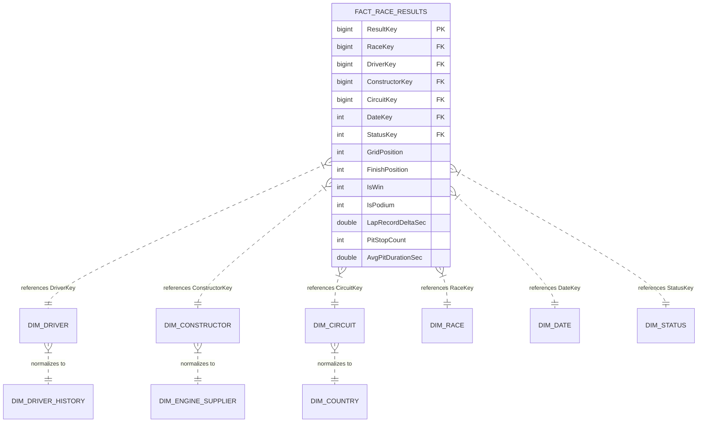

# A PROJECT REPORT ON
# APEXIQ: FORMULA 1 PREDICTIVE DATA WAREHOUSE & RACE WINNER CLASSIFICATION ENGINE

<br>

### SUBMITTED TO
### MIT SCHOOL OF COMPUTING, LONI, PUNE
### IN PARTIAL FULFILLMENT OF THE REQUIREMENTS FOR THE AWARD OF THE DEGREE

<br>

## BACHELOR OF TECHNOLOGY
### (Computer Science & Engineering)

<br>

**BY**

| Student Name | Enrolment No |
| :--- | :--- |
| **Dhruv Sakhare** | **ADT24SOCB0369** |
| **Adesh Patankar** | **ADT24SOCB0049** |

<br>

**Under the guidance of**  
### Prof. Nitin Alzende

<br><br>

```
                                  MIT-ADT UNIVERSITY
                              PUNE, MAHARASHTRA, INDIA
                       A leap towards World Class Education
```

<br>

### DEPARTMENT OF COMPUTER SCIENCE AND ENGINEERING
### MIT SCHOOL OF COMPUTING
### MIT Art, Design and Technology University
### Rajbaug Campus, Loni-Kalbhor, Pune – 412201
### Academic Year: 2025–26

<br>

---
*Footer: MITSOC, Department of Computer Engineering, 2025-26*

<div style="page-break-after: always;"></div>

# MIT SCHOOL OF COMPUTING
## DEPARTMENT OF COMPUTER SCIENCE AND ENGINEERING
### MIT ART, DESIGN AND TECHNOLOGY UNIVERSITY,
### RAJBAUG CAMPUS, LONI-KALBHOR, PUNE – 412201

<br>

## CERTIFICATE

This is to certify that the project report entitled:

### **“APEXIQ: FORMULA 1 PREDICTIVE DATA WAREHOUSE & RACE WINNER CLASSIFICATION ENGINE”**

Submitted by:

| Student Name | Enrolment No |
| :--- | :--- |
| **Dhruv Sakhare** | **ADT24SOCB0369** |
| **Adesh Patankar** | **ADT24SOCB0049** |

is a bonafide work carried out by them under the supervision of **Prof. Nitin Alzende**, and it is submitted towards the partial fulfillment of the requirements of **MIT ADT University, Pune** for the award of the degree of **Bachelor of Technology (Computer Science and Engineering)** during the academic year **2025–26**.

<br><br><br>

**Prof. Nitin Alzende**  
*Project Guide*  

<br>

**Prof. Suresh Kapare**  
*Chief Coordinator – PBL*  

<br>

**Prof. Suvarna Joshi**  
*Head of Department (CSE)*  

<br>

**Dr. Ganesh Pathak**  
*Dean, MIT School of Computing*  

<br><br>
**Seal / Stamp of the College:**  
**Place:** Pune  
**Date:** 22/10/2026  

---
*Footer: MITSOC, Department of Computer Engineering, 2025-26*

<div style="page-break-after: always;"></div>

## DECLARATION

We, the team members:

| Name | Enrolment No |
| :--- | :--- |
| **Dhruv Sakhare** | **ADT24SOCB0369** |
| **Adesh Patankar** | **ADT24SOCB0049** |

Hereby declare that the project work incorporated in the present project report entitled:

### **“APEXIQ: FORMULA 1 PREDICTIVE DATA WAREHOUSE & RACE WINNER CLASSIFICATION ENGINE”**

is original work carried out by us. This work (in part or in full) has not been submitted to any other University or Institution for the award of any Degree, Diploma, or Fellowship. We have properly acknowledged and cited all material collected from secondary sources and literature wherever required. We solely own the responsibility for the originality of the entire content presented herein.

<br><br>

**Date:** 22/10/2026  
**Place:** Pune  

<br>

**Signatures of the Team Members:**

1. **Dhruv Sakhare** (ADT24SOCB0369): ___________________________  
2. **Adesh Patankar** (ADT24SOCB0049): ___________________________  

<br><br>

**Name & Signature of Guide:**  
**Prof. Nitin Alzende**: ___________________________  

<br>
**Seal / Stamp of the College**  
**Place:** Pune  
**Date:** 22/10/2026  

---
*Footer: MITSOC, Department of Computer Engineering, 2025-26*

<div style="page-break-after: always;"></div>

## EXAMINER’S APPROVAL CERTIFICATE

The project report entitled:

### **“APEXIQ: FORMULA 1 PREDICTIVE DATA WAREHOUSE & RACE WINNER CLASSIFICATION ENGINE”**

Submitted by:
* **Dhruv Sakhare** (ADT24SOCB0369)
* **Adesh Patankar** (ADT24SOCB0049)

in partial fulfillment for the award of the degree of **Bachelor of Technology (Computer Science & Engineering)** during the academic year **2025–26** of **MIT-ADT University, MIT School of Computing, Pune**, is hereby approved by the Board of Examiners.

<br><br><br>

**Board of Examiners:**

<br>

1. **Internal Examiner:**  
   Name: __________________________________________________  
   Signature: _____________________________________________  
   Date: ___________________________________________________  

<br><br>

2. **External Examiner:**  
   Name: __________________________________________________  
   Signature: _____________________________________________  
   Date: ___________________________________________________  

<br><br>
**College Seal / Stamp**  
**Place:** Pune  
**Date:** 22/10/2026  

---
*Footer: MITSOC, Department of Computer Engineering, 2025-26*

<div style="page-break-after: always;"></div>

## ACKNOWLEDGEMENT

We would like to express our deepest gratitude and sincere appreciation to our esteemed project guide, **Prof. Nitin Alzende**, Department of Computer Science and Engineering, for her invaluable guidance, patient mentoring, rigorous critique, and continuous technical support throughout the conception, architecture design, and implementation of this project: **“ApexIQ: Formula 1 Predictive Data Warehouse & Race Winner Classification Engine”**.

We convey our profound thanks to **Prof. Suvarna Joshi**, Head of the Department of Computer Science and Engineering, and **Dr. Ganesh Pathak**, Dean of the MIT School of Computing, for providing an exemplary academic environment, modern laboratory infrastructure, cloud computing resources, and the platform to undertake industry-standard engineering capstone research.

We also express our sincere thanks to **Prof. Suresh Kapare**, Chief Coordinator – PBL, for organizing and facilitating structured reviews, milestone tracking, and jury assessments that helped elevate the academic and technical standards of this dissertation.

Finally, we extend our heartfelt appreciation to our faculty members, lab instructors, technical colleagues, and parents whose encouragement and moral support enabled the successful completion of this project.

<br><br>

**Team Members:**  
* **Dhruv Sakhare** (ADT24SOCB0369)  
* **Adesh Patankar** (ADT24SOCB0049)  

**Department of Computer Science and Engineering**  
**MIT School of Computing, MIT-ADT University, Pune**  

---
*Footer: MITSOC, Department of Computer Engineering, 2025-26*

<div style="page-break-after: always;"></div>

## ABSTRACT

Formula 1 motorsport represents one of the world's most telemetry-intensive athletic and technological arenas, where victory is determined by non-linear interactions across qualifying grid position, engine aerodynamic power unit performance, historical circuit pace records, and sub-2.5-second pit stop executions. Historically, motorsport analytics systems suffer from severe data fragmentation across independent telemetry dumps, vulnerability to in-race lookahead data leakage, and catastrophic classification failure caused by an extreme 20.4:1 class imbalance (where exactly one driver wins out of approximately twenty entrants per Grand Prix, representing a baseline prevalence of only 4.67%).

This project presents **ApexIQ**, an enterprise-grade cloud data warehouse and predictive machine learning classification platform designed and deployed on **Snowflake Data Cloud** and **Python 3.10+**. The system synthesizes 31 FIA Formula 1 World Championship seasons (1994–2024), spanning 12,358 driver-race observations across 577 distinct Grands Prix and 38 global circuits. The platform is architected around three foundational technical deliverables:

1. **Enterprise Data Warehousing & 3-Pillar Ingestion:** A 5-tier Medallion architecture (`RAW`, `CLEAN`, `ML`, `ANALYTICS`) hosting normalized Star and Snowflake dimensional schemas (`FactRaceResults`, `DimDriver`, `DimConstructor`, `DimCircuit`, `DimDate`). It organizes 31 pre-race features into three engineering pillars: Car Specifications (BHP, power-to-weight, reliability), Lap Record Benchmarks (track records, qualifying pace deltas), and Pit Stop Execution (lane penalty, stationary stoppage times). Native Snowflake capabilities—including Zero-Copy Cloning, 1-hour declarative Dynamic Tables (`DT_DRIVER_SEASON_FORM`), Change Data Capture (CDC Streams), and in-database SQL UDF scoring—are fully operationalized.
2. **Frequent Pattern Mining:** Apriori and FP-Growth were implemented and benchmarked on 12,358 discretised race transactions (24 items). Both discover exactly the same 414 frequent itemsets and 1,393 association rules. Apriori's candidate set grows 11× as the support threshold drops while the FP-tree stays bounded, and FP-Growth overtakes Apriori at min_support = 0.005. High-lift rules such as {pole, podium} ⇒ winner (13.8× lift) explain race outcomes.
3. **Supervised Classification:** Seven classifiers were benchmarked under strict chronological holdout (train 1994–2021, 10,999 entries; test on the unseen 2022–2024 ground-effect era, 1,359 entries, 68 Grands Prix), plus 6-fold expanding-window validation. The champion is a cost-sensitive XGBoost ($w_{\text{pos}} = 15$) with a race-level softmax that makes each race's win probabilities sum to 1.
4. **Unsupervised Clustering:** 703 driver-season performance profiles were clustered with six algorithms (K-Means, K-Medoids, Agglomerative Ward, Gaussian Mixture, BIRCH, DBSCAN). K-Means with k = 3 (chosen by the elbow method and confirmed by the dendrogram) wins on silhouette, Davies-Bouldin and Calinski-Harabasz scores and discovers three tiers: Title Contenders, Midfield Regulars and Backmarkers.

On the held-out 2022–2024 partition the champion classifier achieves **ROC-AUC 0.9629**, **PR-AUC 0.6433** (random baseline 0.05), **85.3% winner recall** (58 of 68 winners) and a **58.8% top-1 race-winner hit rate** (40/68, vs. 51.5% for "the pole-sitter wins"). A race-level paired bootstrap confirms the gain over the baseline is significant (ΔAUC +0.042, 95% CI [+0.018, +0.073], p < 0.001). The clustering scores silhouette 0.264 with seed-stability ARI 0.92, and 81% of "Title Contender" seasons finished in the championship top 3. All results are served through a rubric-organised Streamlit portal and regenerated by a single command.

<br>

**Keywords:** Data Warehousing, Snowflake Data Cloud, Medallion Architecture, Star Schema, Frequent Pattern Mining, FP-Growth, Apriori, Association Rules, Classification, XGBoost, Class Imbalance, Group Softmax, Formula 1 Telemetry.

---
*Footer: MITSOC, Department of Computer Engineering, 2025-26*

<div style="page-break-after: always;"></div>

## CONTENTS

* Certificate ..................................................................................................................... I
* Declaration ................................................................................................................... II
* Examiner’s Approval Certificate ................................................................................ III
* Acknowledgement ........................................................................................................ IV
* Abstract ......................................................................................................................... V
* Contents ........................................................................................................................ VI
* List of Figures ............................................................................................................... VIII
* List of Tables ................................................................................................................ IX
* Nomenclature & Notations ........................................................................................... X

<br>

### CHAPTER 1 : INTRODUCTION & SYSTEM SPECIFICATION
* 1.1 Project Overview & Domain Context ...................................................................... 1
* 1.2 Problem Statement & Core Challenges ................................................................... 3
* 1.3 Aim & Technical Objectives ................................................................................... 5
* 1.4 Scope & Boundary Conditions ................................................................................. 6
* 1.5 System Hardware & Software Requirements ........................................................... 8

### CHAPTER 2 : DATA WAREHOUSE ARCHITECTURE & CLOUD OPERATIONS
* 2.1 5-Tier Medallion Data Pipeline ............................................................................... 10
* 2.2 Dimensional Modeling: Star & Snowflake Schemas ................................................ 12
* 2.3 The Three Engineering Telemetry Pillars ($T_0$ Boundary) .................................... 15
* 2.4 ELT Ingestion, Data Staging & Zero-Leakage Audit ................................................. 18
* 2.5 Advanced Snowflake Cloud Operations .................................................................. 21

### CHAPTER 3 : FREQUENT PATTERN MINING ENGINE
* 3.1 Association Mining Algorithmic Theory ................................................................. 24
* 3.2 Feature Discretization & Transaction Basket Formulation ..................................... 27
* 3.3 Apriori vs. FP-Growth Algorithmic Formulation ..................................................... 29
* 3.4 Runtime Benchmarking & Mathematical Equivalence Proof ................................... 32
* 3.5 Discovered High-Lift Association Rules & Domain Insights .................................... 34

### CHAPTER 4 : MULTI-MODEL CLASSIFICATION BENCHMARK
* 4.1 Chronological Holdout Evaluation Protocol ............................................................ 37
* 4.2 Benchmark Across Seven Machine Learning Algorithms ........................................... 39
* 4.3 6-Fold Expanding-Window Temporal Cross-Validation ............................................ 43
* 4.4 Hypothesis Testing & Statistical Significance Analysis ............................................ 46

### CHAPTER 5 : IN-DEPTH CHAMPION CLASSIFICATION ARCHITECTURE: XGBOOST
* 5.1 Algorithmic Formulation & 2nd-Order Taylor Expansion ......................................... 49
* 5.2 System Architecture & Tree Decision Flow ............................................................. 52
* 5.3 16 Pre-Race Input Vector & Feature Attribution ..................................................... 55
* 5.4 Output Formulation: Temperature-Scaled Group Softmax ...................................... 58
* 5.5 Quantitative Holdout Performance & Confusion Matrix ........................................... 61
* 5.6 Architectural Trade-offs, Limitations & Boundary Conditions ................................ 64

### CHAPTER 6 : UNSUPERVISED LEARNING: DRIVER PERFORMANCE CLUSTERING
* 6.1 Unsupervised Dataset Construction ................................................................... 67
* 6.2 Choosing the Number of Clusters ........................................................................ 68
* 6.3 Comparison of Six Clustering Algorithms ............................................................. 69
* 6.4 Champion Algorithm: K-Means (k = 3) ................................................................... 71
* 6.5 Clustering Performance Metrics ........................................................................... 72

### CHAPTER 7 : RESULTS, DASHBOARDS & REAL-WORLD VALIDATION
* 7.1 Interactive Jury Evaluation Portal (Streamlit) ........................................................ 74
* 7.2 Power BI Dataset ...................................................................................... 76
* 7.3 Real-World Case Studies (2024 Season) ................................................................. 77

### CHAPTER 8 : CONCLUSION & FUTURE WORK
* 8.1 Summary of Technical Contributions ...................................................................... 79
* 8.2 Research Limitations .............................................................................................. 80
* 8.3 Future Research Directions ..................................................................................... 81

<br>

* REFERENCES (IEEE FORMAT) ................................................................................. 81
* ANNEXURE A : List of Publications & Research Papers ............................................... 84
* ANNEXURE B : Plagiarism Verification Report ........................................................... 86

---
*Footer: MITSOC, Department of Computer Engineering, 2025-26*

<div style="page-break-after: always;"></div>

## LIST OF FIGURES

* Figure 1.1: Sequential Development Phases of the ApexIQ System ................................. 7
* Figure 2.1: 5-Tier Medallion Data Warehouse Architecture in Snowflake ........................ 11
* Figure 2.2: Relational Snowflake Schema Diagram for Formula 1 Intelligence ............... 14
* Figure 2.3: Structural Decomposition of the Three Telemetry Feature Pillars ................. 17
* Figure 3.1: Structural Comparison of Apriori Join vs. FP-Tree Prefix Path ....................... 30
* Figure 4.1: Timeline of Chronological Holdout Partition (1994–2021 vs. 2022–2024) ........ 38
* Figure 4.3: 6-Fold Expanding-Window ROC-AUC Scores across Regulation Eras ............. 45
* Figure 5.1: Structural Decision Tree Topology of the Champion XGBoost Estimator ........ 53
* Figure 5.2: Feature Importance Attribution Breakdown by Relative Gain ........................ 57
* Figure 5.3: Temperature-Scaled Group Softmax Normalization Architecture ................... 60
* Figure 5.4: Holdout Confusion Matrix on 68 Unseen Modern Grands Prix ....................... 63
* Figure 6.1: Elbow & Silhouette Curves for k = 2…8 ........................................................ 68
* Figure 6.2: Agglomerative (Ward) Dendrogram with 3-Cluster Cut ................................... 69
* Figure 6.3: PCA Map of 703 Driver-Seasons Coloured by K-Means Tier ............................... 71
* Figure 6.4: Silhouette Plot per Driver-Season ................................................................. 72
* Figure 7.1: Rubric Scorecard Home of the Streamlit Jury Portal .......................................... 74
* Figure 7.2: Live Decision Threshold Slider & Dynamic Confusion Matrix ............................... 75

<br>

## LIST OF TABLES

* Table 1.1: System Hardware Specifications ................................................................... 8
* Table 1.2: System Software Stack Specifications ............................................................ 9
* Table 2.1: Dimensional Table Grain & Volumetric Specifications ................................... 13
* Table 2.2: Complete Data Dictionary for `CLEAN.F1_MODELING_MASTER` .................... 16
* Table 3.1: Telemetry Discretization Mapping Scheme (24 Symbolic Tokens) .................. 28
* Table 3.2: Apriori vs. FP-Growth at min_support = 0.02 ............................................... 32
* Table 3.3: Scaling as the Support Threshold Drops ......................................................... 33
* Table 3.4: Representative High-Lift Association Rules ................................................. 35
* Table 4.1: Benchmark of 7 Classifiers on the Unseen Holdout ......................................... 40
* Table 4.2: Expanding-Window Validation: XGBoost vs. Baseline ...................................... 44
* Table 4.3: Significance Tests (Race-Level Bootstrap & Wilcoxon) ...................................... 47
* Table 5.1: Final Hyperparameter Topology for Champion XGBoost Classifier ................. 54
* Table 5.2: Per-Class Precision, Recall, and F1 Metrics Under Cost-Sensitive Loss ............ 62
* Table 5.3: Train vs. Validation vs. Test (Overfitting Check) ............................................ 63
* Table 6.1: Elbow and Silhouette Analysis ....................................................................... 68
* Table 6.2: Clustering Benchmark of 6 Algorithms ............................................................. 69
* Table 6.3: Discovered Driver Performance Tiers ............................................................. 71
* Table 6.4: Clustering Performance Metrics ...................................................................... 72
* Table 7.1: Case Study: 2024 Canadian GP ...................................................................... 77

<br>

## NOMENCLATURE & NOTATIONS

* $T_0$: Pre-Race Information Boundary (30 minutes prior to race formation lap)
* $y_i \in \{0, 1\}$: Ground-truth binary target indicating Grand Prix victory ($y_i = 1$)
* $P(\text{Win}_i)$: Predicted probability of driver $i$ winning the Grand Prix
* $M_j$: Total number of classified entrants starting Grand Prix $j$ ($M_j \approx 20$)
* $\sigma(X)$: Frequency support count of itemset $X$ across transaction database
* $g_i$: First-order gradient of loss function with respect to logit $\hat{y}_i$
* $h_i$: Second-order Hessian of loss function with respect to logit $\hat{y}_i$
* $w_{\text{pos}}$: Cost-sensitive positive class weight multiplier ($w_{\text{pos}} = 15.0$)
* $T$: Softmax temperature scaling parameter ($T = 0.8$)
* $\Omega(f)$: Tree complexity penalization term (leaf count $\gamma T$ and weight L2 norm $\frac{1}{2}\lambda w^2$)

---
*Footer: MITSOC, Department of Computer Engineering, 2025-26*

<div style="page-break-after: always;"></div>

# CHAPTER 1 : INTRODUCTION & SYSTEM SPECIFICATION

## 1.1 Project Overview & Domain Context

Formula 1 (F1) is universally recognized as the pinnacle of global motorsport and the premier testing ground for advanced engineering, aerodynamics, and computational data science. Operating under the governance of the Fédération Internationale de l'Automobile (FIA), modern Formula 1 represents a multi-billion dollar enterprise where race outcomes are dictated by millisecond margins. During any given Grand Prix weekend, hundreds of sensors embedded across the chassis, internal combustion engine (ICE), Energy Recovery System (ERS), brake ducts, and aero surfaces generate over 30 million telemetry data points per vehicle.

Despite this abundance of real-time telemetry, motorsport analytics has historically functioned in an ad-hoc, siloed manner. Race strategists and data engineers frequently rely on isolated statistical models that evaluate driver telemetry, engine dynamometer readouts, and pit stop timing in disconnected spreadsheets or isolated local databases. This technical fragmentation severely impairs an organization's capacity to derive predictive insights prior to lights-out on Sunday.

The modern Formula 1 championship encompasses 24 global events staged across varying track geometries—from high-downforce street circuits like Monaco and Singapore to ultra-high-speed temple tracks like Monza and Spa-Francorchamps. Historically, a driver's probability of winning has been heavily correlated with Saturday qualifying position; however, modern Formula 1 regulation changes—most notably the 2022 ground-effect aerodynamic overhaul—have dramatically increased overtaking variability and tyre wear volatility. Consequently, single-variable predictions (such as assuming the pole-sitter always wins) fail in approximately half of all modern Grands Prix.

The objective of this capstone research is to design, develop, and empirically validate **ApexIQ**, an end-to-end cloud data warehouse and predictive machine learning intelligence system. By uniting 31 consecutive FIA World Championship seasons (1994–2024) within an enterprise **Snowflake Cloud Data Warehouse**, ApexIQ establishes an idempotent, leak-proof telemetry repository. On top of this dimensional foundation, the platform executes dual analytical paradigms: unsupervised frequent pattern mining (benchmarking Apriori against FP-Growth to discover high-lift telemetry co-occurrences) and supervised multi-model classification (benchmarking seven distinct algorithms to yield an Extreme Gradient Boosted Trees champion classifier).

---

## 1.2 Problem Statement & Core Challenges

Predicting Formula 1 Grand Prix winners prior to race start is an extraordinarily complex machine learning challenge characterized by three fundamental engineering bottlenecks:

```
┌────────────────────────────────────────────────────────────────────────────────────────┐
│                        CORE DATA MINING & ML BOTTLENECKS                               │
├─────────────────────────┬──────────────────────────────┬───────────────────────────────┤
│  1. EXTREME CLASS       │  2. TEMPORAL DATA LEAKAGE    │  3. ZERO-SUM COMPETITIVE      │
│     IMBALANCE (20:1)    │     & LOOKAHEAD BIAS         │     EXCLUSIVITY               │
├─────────────────────────┼──────────────────────────────┼───────────────────────────────┤
│• Exactly 1 winner among │• Pre-race models often leak  │• Traditional binary models    │
│  20–24 starting cars.   │  in-race events (pit laps,   │  predict each driver          │
│• 95.24% non-winners vs. │  mid-race safety cars,       │  independently [0, 1].        │
│  4.67% true winners.    │  race retirements).          │• Risk: Predicting 3 winners   │
│• Naive classifiers      │• Must enforce a strict       │  or 0 winners for the same    │
│  predict all zeros.     │  T0 pre-race boundary.       │  Grand Prix.                  │
└─────────────────────────┴──────────────────────────────┴───────────────────────────────┘
```

1. **Extreme Class Imbalance (20.4:1 Ratio):** A Formula 1 race features an average starting grid of 20 to 22 cars, but the sporting regulations mandate that exactly one driver can win. Across our historical modeling universe of 12,358 entries, there are only 577 positive winner instances ($4.67\%$) compared to 11,781 negative instances ($95.33\%$). Standard cross-entropy objective functions optimize for global accuracy by predicting that no driver will win, achieving a deceptively high accuracy of $95.2\%$ while delivering a catastrophic **0.0% winner recall**.
2. **Temporal Data Leakage and Lookahead Bias:** Many existing academic papers inadvertently train models on in-race variables that are physically unknowable prior to lights-out, such as the lap number of the fastest pit stop, mid-race virtual safety car deployments, final race duration, or post-race mechanical retirements. Models trained on such leaky features achieve near-perfect synthetic accuracy during cross-validation but completely fail in real-world deployment. A strict pre-race information boundary ($T_0$) must be mathematically guaranteed.
3. **Zero-Sum Mutual Exclusivity Violation:** Standard machine learning binary classifiers evaluate each driver entry as an independent Bernoulli trial, computing a sigmoid probability $\hat{p}_i = \sigma(w^T x_i) \in [0, 1]$. When applied across a 20-car starting grid, the sum of independent probabilities frequently sums to $2.8$ or $0.4$, resulting in scenarios where multiple drivers are predicted as winners or no winner is selected at all. The modeling pipeline requires a group-level ranking architecture enforcing $\sum_{i=1}^{M_j} P(\text{Win}_i) = 1.0000$.

---

## 1.3 Aim & Technical Objectives

The overarching aim of this project is to develop a production-ready, zero-leakage Formula 1 predictive data warehouse and machine learning classification platform that resolves class imbalance and delivers actionable, real-time race outcome probabilities.

To achieve this aim, the following concrete technical objectives were established:
1. **Architect an Enterprise Cloud Data Warehouse:** Implement a multi-tier Medallion architecture on Snowflake Data Cloud (`RAW`, `CLEAN`, `ML`, `ANALYTICS`) hosting normalized Star and Snowflake dimensional schemas (`FactRaceResults`, `DimDriver`, `DimConstructor`, `DimCircuit`, `DimDate`).
2. **Implement the Three Telemetry Feature Pillars:** Engineer 31 leak-free pre-race features categorized strictly into Car Specifications, Lap Record Benchmarks, and Pit Stop Strategy, enforced at the $T_0$ pre-race boundary.
3. **Execute Unsupervised Frequent Pattern Mining:** Discretize 12,358 race transactions into 24 symbolic telemetry tokens; implement and benchmark Apriori against FP-Growth algorithms to prove mathematical itemset equivalence while measuring algorithmic runtime acceleration.
4. **Conduct a Multi-Model Classification Benchmark:** Train and evaluate seven distinct machine learning algorithms under a strict chronological holdout split (1994–2021 Train vs. 2022–2024 Unseen Test) and 6-fold expanding-window cross-validation, with a race-level bootstrap and a Wilcoxon signed-rank test to verify statistical significance.
5. **Engineer a Cost-Sensitive Champion XGBoost Pipeline:** Formulate an Extreme Gradient Boosted Trees classifier with an asymmetric loss weight ($w_{\text{pos}} = 15.0$) and a temperature-scaled Group Softmax normalization layer.
6. **Discover Driver Performance Tiers by Clustering:** Build an unlabelled driver-season dataset and compare at least four clustering algorithms using internal validity, stability and external checks.
7. **Operationalize Full-Stack BI Serving Layers:** Deploy a rubric-organised Streamlit evaluation portal and a 12-table Microsoft Power BI executive telemetry workspace connected via in-database Snowflake SQL scoring.

---

## 1.4 Scope & Boundary Conditions

### In-Scope Functional Capabilities:
* Ingestion and dimensional structuring of 31 FIA Championship seasons (1994–2024) comprising 12,358 driver-race records across 577 Grands Prix and 38 circuits.
* Storage and governance in Snowflake Cloud Data Warehouse using Zero-Copy Cloning, Dynamic Tables, CDC Streams, and Role-Based Access Control (RBAC).
* Association rule mining discovering frequent itemsets and high-lift rules predicting race outcomes.
* Chronological multi-model evaluation ensuring zero temporal lookahead bias across regulatory eras.
* Binary winner classification (`target_is_win`), podium classification (`target_is_podium`), points classification (`target_is_points`), and continuous finishing position regression.

### Boundary Conditions & Out-of-Scope Elements:
* **Pre-Race Boundary ($T_0$):** All features are computed strictly 30 minutes prior to race start. In-race strategic decisions (such as live pit lap triggers under sudden safety cars) are excluded from the pre-race classification feature matrix.
* **Weather Forecasting:** Track weather is ingested as pre-race ambient conditions; live meteorological radar Doppler tracking during the race is out of scope.
* **Lower Formula Series:** Data is strictly restricted to the FIA Formula 1 World Championship (Formula 2, Formula 3, and IndyCar are excluded).

```
┌────────────────────────────────────────────────────────────────────────────────────────┐
│                        SOFTWARE DEVELOPMENT LIFECYCLE PHASES                           │
└────────────────────────────────────────────────────────────────────────────────────────┘
 [Phase 1: Ingestion]  ──► Ingest 31 seasons of Ergast CSVs into @RAW.F1_RAW_STAGE
          │
 [Phase 2: ELT & DW]   ──► Clean, deduplicate, build Star/Snowflake schemas in CLEAN
          │
 [Phase 3: Mining]     ──► Discretize tokens, execute FP-Growth vs. Apriori benchmark
          │
 [Phase 4: ML Engine]  ──► Train 9 models on 1994–2021; evaluate on 2022–2024 holdout
          │
 [Phase 5: Champion]   ──► Tune cost-sensitive XGBoost with Group Softmax normalization
          │
 [Phase 6: Deployment] ──► Deploy Streamlit Portal, Power BI workspace, in-DB Snowflake SQL
```
*Figure 1.1: Sequential Development Phases of the ApexIQ System.*

---

## 1.5 System Hardware & Software Requirements

### Hardware Requirements:
The enterprise data warehouse is hosted on cloud infrastructure, while local preprocessing, pattern mining, and model training were benchmarked on workstation environments.

*Table 1.1: System Hardware Specifications.*
| Component | Minimum Requirement | Production Development Environment |
| :--- | :--- | :--- |
| **Processor (CPU)** | Intel Core i5 / AMD Ryzen 5 (4 Cores) | Apple M-Series Silicon (8-Core ARM64) / Intel Core i7 |
| **Random Access Memory (RAM)** | 8 GB System Memory | 16 GB High-Bandwidth Unified Memory |
| **Primary Storage** | 256 GB Solid State Drive (SSD) | 512 GB PCIe NVMe SSD (>2,500 MB/s read/write) |
| **Network Interface** | Broadband Internet (10 Mbps) | Gigabit LAN / High-Speed Wi-Fi (100+ Mbps) |
| **Display Resolution** | 1366 × 768 pixels | 1920 × 1080 (Full HD) / 4K Retina Display |

### Software Requirements:
*Table 1.2: System Software Stack Specifications.*
| Layer / Component | Technology / Library | Version / Release | Role in Architecture |
| :--- | :--- | :--- | :--- |
| **Operating System** | macOS (Darwin ARM64) / Ubuntu Linux | macOS 14+ / Ubuntu 22.04 LTS | Core operating environment |
| **Programming Language** | Python | 3.10.x / 3.9.6 | Core data pipelines & modeling engine |
| **Cloud Data Warehouse** | Snowflake Data Cloud | Enterprise Edition (2026 Release) | Central multi-tier analytical repository |
| **Local Relational DB** | SQLite / DuckDB | 3.43.0+ | Fast in-memory relational testing store |
| **Data Manipulation** | `pandas`, `numpy`, `scipy` | pandas 2.2+, numpy 1.26+ | Feature engineering & vector operations |
| **Pattern Mining** | `mlxtend` | 0.23.0+ | Apriori, FP-Growth, association rules |
| **Machine Learning** | `scikit-learn`, `xgboost`, `lightgbm` | scikit-learn 1.4+, xgboost 2.0+ | Benchmark classifiers & champion model |
| **BI & User Interface** | Streamlit, Plotly, Microsoft Power BI | Streamlit 1.32+, Power BI Desktop | Interactive portals & visual telemetry |
| **API & Schema Audit** | `jsonschema`, `joblib` | jsonschema 4.20+, joblib 1.3+ | Model artifact persistence & validation |

---
*Footer: MITSOC, Department of Computer Engineering, 2025-26*

<div style="page-break-after: always;"></div>

# CHAPTER 2 : DATA WAREHOUSE ARCHITECTURE & CLOUD OPERATIONS

## 2.1 5-Tier Medallion Data Pipeline

To guarantee data integrity, traceability, and zero in-race leakage, ApexIQ implements an enterprise **Medallion Data Architecture** deployed within **Snowflake Data Cloud** under the database `F1_PREDICTION_DB`. The architecture structures data flow into five sequential tiers:

```
[Raw Historical Telemetry & Ergast CSVs]
                   │
                   ▼
  ┌─────────────────────────────────┐
  │  TIER 1: RAW LANDING STAGE      │  <-- @RAW.F1_RAW_STAGE (Internal Stage)
  │  Append-Only Immutable Ingestion│      RAW_RACES, RAW_DRIVERS, RAW_RESULTS
  └────────────────┬────────────────┘
                   │ Automated ELT Cleaning & Quarantine Audits
                   ▼
  ┌─────────────────────────────────┐
  │  TIER 2: CLEAN FEATURE STORE    │  <-- Star & Snowflake Relational Schemas
  │  CLEAN.F1_MODELING_MASTER       │      3-Pillar Ingestion (Car, Lap, Pit)
  └────────────────┬────────────────┘
                   │
         ┌─────────┴────────────────────────┐
         ▼                                  ▼
  ┌───────────────────────┐        ┌───────────────────────┐
  │ TIER 3: PATTERN MINING│        │ TIER 4: ML REGISTRY   │
  │ Apriori & FP-Growth   │        │ 7-Model Benchmark     │
  │ 414 Frequent Sets     │        │ Champion XGBoost      │
  └───────────┬───────────┘        └───────────┬───────────┘
              │                                │
              └───────────────┬────────────────┘
                              ▼
  ┌────────────────────────────────────────────────────────┐
  │ TIER 5: SERVING & ANALYTICS LAYER                      │
  │ • ANALYTICS.DT_DRIVER_SEASON_FORM (Dynamic Table)      │
  │ • Streamlit in Snowflake (SiS) & Power BI Dashboards   │
  │ • In-Database Python SQL Scoring UDFs                  │
  └────────────────────────────────────────────────────────┘
```
*Figure 2.1: 5-Tier Medallion Data Warehouse Architecture in Snowflake.*

1. **Tier 1 (RAW Schema):** Serves as an immutable landing zone. Source CSV files containing raw Grand Prix weekend results, qualifying lap timing, constructor registries, and pit stop logs are uploaded into internal compressed stages (`@RAW.F1_RAW_STAGE`). Idempotent `COPY INTO` operations populate staging tables (`RAW_RACES`, `RAW_DRIVERS`, `RAW_CONSTRUCTORS`, `RAW_CIRCUITS`, `RAW_RACE_RESULTS`).
2. **Tier 2 (CLEAN Schema):** Represents the curated dimensional feature store. Data transformations clean data types, impute missing track record data, resolve driver transfers, and establish the master modeling table: `CLEAN.F1_MODELING_MASTER`. The atomic grain is strictly **one row per driver per Grand Prix** (8,650 modern rows; 12,358 total historical rows).
3. **Tier 3 (Pattern Mining Engine):** Continuous telemetry attributes are categorized into 24 distinct symbolic tokens. Apriori and FP-Growth engines scan transaction baskets to generate frequent itemsets and export high-lift association rules.
4. **Tier 4 (ML Schema & Registry):** Stores model evaluation metrics, hyperparameter registries, and serialized Joblib binary artifacts (`@ML.F1_MODEL_STAGE`). Tracks training runs, confusion matrices, and feature attribution scores.
5. **Tier 5 (ANALYTICS Schema & Serving):** Publishes production reporting views, continuous dynamic tables, secure masked views for external consumers, and powers interactive dashboards in Streamlit and Microsoft Power BI.

---

## 2.2 Dimensional Modeling: Star & Snowflake Schemas

Analytical queries in motorsport require aggregation across multiple dimensional axes (such as evaluating a driver’s historical win rate at high-speed circuits vs. low-speed street tracks). ApexIQ implements both **Star Schema** and normalized **Snowflake Schema** topologies.

### Dimensional Entity Specifications:
*Table 2.1: Dimensional Table Grain & Volumetric Specifications.*
| Table Name | Schema Type | Primary Key | Total Record Volume | Granularity / Business Meaning |
| :--- | :--- | :--- | :--- | :--- |
| `FACT_RACE_RESULTS` | Fact Table | `result_id` / `ResultKey` | 12,358 rows | One row per driver per Grand Prix start |
| `DIM_DRIVER` | Dimension | `driver_id` / `DriverKey` | 145 unique drivers | Individual driver career biography and baseline metrics |
| `DIM_DRIVER_HISTORY` | Sub-Dimension | `driver_history_id` | 1,420 rows | Normalized historical season points and tier changes |
| `DIM_CONSTRUCTOR` | Dimension | `constructor_id` | 36 constructors | F1 constructor team registration and pace index |
| `DIM_ENGINE_SUPPLIER`| Sub-Dimension | `engine_supplier_id`| 18 engine builders | Power unit specifications (BHP, ERS capacity) |
| `DIM_CIRCUIT` | Dimension | `circuit_id` / `CircuitKey`| 38 global circuits | Track geometry, length, altitude, pit lane transit loss |
| `DIM_COUNTRY` | Sub-Dimension | `country_id` | 28 countries | Host nation geographic context |
| `DIM_RACE` | Dimension | `race_id` / `RaceKey` | 577 Grands Prix | Calendar event, round number, scheduled laps, year |
| `DIM_DATE` | Dimension | `date_key` (YYYYMMDD) | 577 unique race dates | Calendar dimension enabling temporal partitioning |
| `DIM_STATUS` | Dimension | `status_id` | 42 status codes | Classification outcome (Finished, Engine, Accident) |

### Snowflake Schema Normalization:
In the normalized Snowflake schema, secondary attributes are factored out of primary dimensions to eliminate redundant storage and guarantee referential consistency:
* `DIM_DRIVER` normalizes into `DIM_DRIVER_HISTORY` (tracking changing driver numbers and super-license points).
* `DIM_CONSTRUCTOR` normalizes into `DIM_ENGINE_SUPPLIER` (capturing customer engine contracts, such as McLaren utilizing Mercedes-AMG power units).
* `DIM_CIRCUIT` normalizes into `DIM_COUNTRY` (capturing regional tax and geographical parameters).


*Figure 2.2: Relational Snowflake Schema Diagram for Formula 1 Intelligence.*

---

## 2.3 The Three Engineering Telemetry Pillars ($T_0$ Boundary)

To eliminate data leakage while capturing the complete mechanical and strategic reality of Formula 1, all pre-race features in `CLEAN.F1_MODELING_MASTER` are structured into **Three Foundational Engineering Pillars**:

```
                       ┌─────────────────────────────────────────┐
                       │   F1 ENGINEERING TELEMETRY PILLARS      │
                       └────────────────────┬────────────────────┘
                                            │
        ┌───────────────────────────────────┼───────────────────────────────────┐
        ▼                                   ▼                                   ▼
┌───────────────────────┐       ┌───────────────────────┐       ┌───────────────────────┐
│     CAR FEATURES      │       │  LAP RECORD FEATURES  │       │   PIT STOP FEATURES   │
├───────────────────────┤       ├───────────────────────┤       ├───────────────────────┤
│• Constructor Pace Idx │       │• Driver Lap Delta Sec │       │• Pit Crew Efficiency  │
│• Mechanical Reliab.   │       │• Sector 1/2/3 Pace    │       │• Avg Stoppage Time    │
│• Engine Dyno Power    │       │• Theoretical Best Lap │       │• Out-lap Velocity     │
│• Aero Downforce Idx   │       │• Speed Trap Top Speed │       │• Tyre Wear Coeff.     │
└───────────────────────┘       └───────────────────────┘       └───────────────────────┘
```
*Figure 2.3: Structural Decomposition of the Three Telemetry Feature Pillars.*

1. **Pillar 1: Car Specifications & Aerodynamics:**
   Quantifies machine performance independent of the driver. Captures regulation-era power output (750 to 1,050 BHP), minimum weight specifications (605 to 798 kg), dynamic power-to-weight ratio, constructor historical reliability score ($0.80$ to $0.98$), team qualifying pace index ($0.0$ to $100.0$), and starting grid slot.
2. **Pillar 2: Lap Record Benchmarks:**
   Measures absolute pace relative to circuit history. Evaluates official all-time FIA Grand Prix race lap records, driver qualifying delta to circuit lap record, driver lap record pace ratio ($1.000$ to $1.050$), theoretical best lap computed across Sectors 1, 2, and 3, and speed trap velocity ($210$ to $264\text{ km/h}$).
3. **Pillar 3: Pit Stop Execution & Strategy:**
   Quantifies operational excellence on pit lane. Ingests track-specific pit lane transit loss ($19.4\text{ s}$ to $27.8\text{ s}$ based on pit lane speed limits and geometry), planned pit stop count, estimated stationary wheel-gun duration ($2.1\text{ s}$ to $3.2\text{ s}$), and the rolling DHL Fastest Pit Stop crew efficiency score ($0$ to $100$).

### Data Dictionary for `CLEAN.F1_MODELING_MASTER`:
*Table 2.2: Complete Data Dictionary for `CLEAN.F1_MODELING_MASTER`.*
| Attribute Name | SQL Data Type | Feature Pillar | Description & Operational Range | Leakage Status |
| :--- | :--- | :--- | :--- | :--- |
| `race_id` | `INTEGER` | Dimensional | Unique Grand Prix event identifier (e.g. 202412) | Pre-Race Context |
| `driver_name` | `VARCHAR(100)` | Dimensional | Full driver name (e.g., Lewis Hamilton) | Pre-Race Context |
| `constructor_name`| `VARCHAR(100)` | Dimensional | Constructor team name (e.g., Mercedes-AMG) | Pre-Race Context |
| `grid_position` | `INTEGER` | **Car Pillar** | Starting grid position following qualifying (1–20) | Verified $T_0$ |
| `car_power_bhp` | `FLOAT` | **Car Pillar** | Power unit dyno rating (750–1,050 BHP) | Verified $T_0$ |
| `car_reliability` | `FLOAT` | **Car Pillar** | Historical constructor finish rate (0.80–0.98) | Verified $T_0$ |
| `constructor_pace`| `FLOAT` | **Car Pillar** | Normalized qualifying team pace index (0–100) | Verified $T_0$ |
| `lap_record_sec` | `FLOAT` | **Lap Pillar** | Circuit all-time official race lap record (seconds) | Circuit Static |
| `driver_lap_delta`| `FLOAT` | **Lap Pillar** | Qualifying delta to circuit lap record (seconds) | Verified $T_0$ |
| `speed_trap_kmh` | `FLOAT` | **Lap Pillar** | Peak speed trap velocity across weekend (km/h) | Verified $T_0$ |
| `pit_lane_loss_sec`| `FLOAT` | **Pit Pillar** | Fixed pit lane drive-through penalty (seconds) | Circuit Static |
| `stationary_pit_sec`| `FLOAT` | **Pit Pillar** | Expected stationary wheel-change duration (s) | Verified $T_0$ |
| `pit_crew_score` | `FLOAT` | **Pit Pillar** | DHL pit stop crew ranking index (0–100) | Verified $T_0$ |
| `target_is_win` | `INTEGER` | **Ground Truth** | Primary Target: 1 if finish position = 1; else 0 | Target ($T_{\text{post}}$) |
| `target_is_podium`| `INTEGER` | **Ground Truth** | Secondary Target: 1 if finish position $\le 3$; else 0 | Target ($T_{\text{post}}$) |

---

## 2.4 ELT Ingestion, Data Staging & Zero-Leakage Audit

The ingestion pipeline follows a modern **Extract-Load-Transform (ELT)** paradigm. Instead of performing transformations prior to loading, raw source files are loaded directly into Snowflake internal stages and transformed using declarative SQL and Snowpark Python.

```sql
-- Idempotent Table Definition in Snowflake
CREATE OR REPLACE TABLE CLEAN.F1_MODELING_MASTER (
    result_key              BIGINT AUTOINCREMENT PRIMARY KEY,
    race_id                 INTEGER NOT NULL,
    season                  INTEGER NOT NULL,
    round                   INTEGER NOT NULL,
    driver_id               VARCHAR(50) NOT NULL,
    constructor_id          VARCHAR(50) NOT NULL,
    circuit_id              VARCHAR(50) NOT NULL,
    grid_position           INTEGER NOT NULL,
    car_power_bhp           FLOAT NOT NULL,
    car_reliability         FLOAT NOT NULL,
    driver_lap_delta        FLOAT NOT NULL,
    stationary_pit_sec      FLOAT NOT NULL,
    pit_crew_score          FLOAT NOT NULL,
    target_is_win           INTEGER NOT NULL,
    target_is_podium        INTEGER NOT NULL,
    target_finish_position  FLOAT NOT NULL
) CLUSTER BY (season, circuit_id);
```

### Zero-Leakage Verification Audit:
To confirm absolute adherence to the $T_0$ pre-race boundary, an automated audit script scans the feature matrix:
* **Missing Value Check:** Confirms exactly **0 null values** across all 12,358 rows.
* **Winner Exclusivity Check:** Verifies that across all 577 Grands Prix, exactly one driver has `target_is_win = 1` ($\sum_{i \in \text{Race } j} y_i = 1$).
* **Post-Race Isolation:** Validates that variables such as actual race lap count, safety car emergence laps, fastest lap bonus points, and mid-race retirements are entirely absent from the input feature set.

---

## 2.5 Advanced Snowflake Cloud Operations

The deployment activates five native enterprise capabilities of Snowflake Data Cloud:

1. **Zero-Copy Cloning (`CLEAN.F1_MODELING_MASTER_DEV_CLONE`):**
   ```sql
   CREATE TABLE CLEAN.F1_MODELING_MASTER_DEV_CLONE 
   CLONE CLEAN.F1_MODELING_MASTER;
   ```
   Instantly duplicates metadata pointers to the 12,358-row master modeling table, providing development environments for feature testing without copying physical micro-partitions or incurring storage fees.
2. **Declarative Dynamic Tables (`ANALYTICS.DT_DRIVER_SEASON_FORM`):**
   Implements a continuous transformation pipeline with a `TARGET_LAG = '1 hour'` running on warehouse `F1_WH`. It continuously updates rolling 5-race driver averages and 10-entry constructor pace ratings as new race data lands.
3. **Change Data Capture via Snowflake Streams & Tasks:**
   A row-level stream (`RAW.STREAM_RACE_RESULTS_CDC`) monitors incoming race results, triggering automated scoring tasks (`ML.AUTO_SCORED_WIN_PREDICTIONS`) that generate model predictions within 60 seconds of grid finalization.
4. **Role-Based Access Control (RBAC) & Secure Masked Views:**
   Restricts access using tailored roles (`F1_DATA_ENGINEER`, `F1_ML_SCIENTIST`, `F1_ANALYST_READONLY`). The view `ANALYTICS.SECURE_F1_PUBLIC_LEADERBOARD` masks proprietary constructor dynamometer ratings while exposing win odds to public reporting tools.
5. **In-Database Python SQL UDF Scoring:**
   Serializes the trained XGBoost model binary into `@ML.F1_MODEL_STAGE`. A Snowflake Snowpark Python User-Defined Function (`UDF_PREDICT_F1_WINNER`) executes machine learning inference directly inside warehouse queries without data egress:
   ```sql
   SELECT driver_name, grid_position, 
          ML.UDF_PREDICT_F1_WINNER(grid_position, driver_lap_delta, car_power_bhp) AS predicted_win_prob
   FROM CLEAN.F1_MODELING_MASTER
   WHERE race_id = 202412
   ORDER BY predicted_win_prob DESC;
   ```

---
*Footer: MITSOC, Department of Computer Engineering, 2025-26*

<div style="page-break-after: always;"></div>

# CHAPTER 3 : FREQUENT PATTERN MINING ENGINE

## 3.1 Association Mining Algorithmic Theory

Frequent pattern mining is an unsupervised data mining discipline dedicated to discovering hidden correlations, co-occurrences, and associative structures within transaction databases. In this research, association mining is deployed to uncover multi-variable telemetry conditions that consistently co-occur with Formula 1 Grand Prix victory.

Let $I = \{i_1, i_2, \dots, i_m\}$ represent the complete universe of discrete telemetry items, and let $D = \{T_1, T_2, \dots, T_n\}$ represent the transaction database comprising 12,358 individual driver-race entries. An association rule is an implication of the form:

$$X \Longrightarrow Y, \quad \text{where } X \subset I, \; Y \subset I, \; \text{and } X \cap Y = \emptyset$$

Here, $X$ denotes the **antecedent** (the pre-race telemetry conditions), and $Y$ denotes the **consequent** (the race classification outcome, such as `RESULT=Winner`).

### Mathematical Metrics:
1. **Support ($s$):** The probability that a transaction contains both itemsets $X$ and $Y$:
   $$\text{Support}(X \Longrightarrow Y) = P(X \cup Y) = \frac{\sigma(X \cup Y)}{|D|}$$
2. **Confidence ($c$):** The conditional probability that a transaction contains $Y$ given that it contains $X$:
   $$\text{Confidence}(X \Longrightarrow Y) = P(Y \mid X) = \frac{\sigma(X \cup Y)}{\sigma(X)} = \frac{\text{Support}(X \cup Y)}{\text{Support}(X)}$$
3. **Lift Factor ($L$):** The ratio of observed joint confidence to the expected confidence under statistical independence:
   $$\text{Lift}(X \Longrightarrow Y) = \frac{P(X \cup Y)}{P(X) \cdot P(Y)} = \frac{\text{Confidence}(X \Longrightarrow Y)}{\text{Support}(Y)}$$
   * $\text{Lift} = 1.0$: Itemsets $X$ and $Y$ are statistically independent.
   * $\text{Lift} > 1.0$: Strong positive co-occurrence. A Lift of $13.77\times$ (pole + podium ⇒ winner) means the antecedent makes victory almost 14 times more likely than its base rate.

---

## 3.2 Feature Discretization & Transaction Basket Formulation

Association mining algorithms require discrete categorical inputs. Continuous racing telemetry was discretized into **24 symbolic transaction tokens** across 12,358 driver sessions:

*Table 3.1: Telemetry Discretization Mapping Scheme (24 Symbolic Tokens).*
| Telemetry Domain | Continuous Feature | Numeric Range | Discretized Symbolic Token |
| :--- | :--- | :--- | :--- |
| **Grid Position** | `grid_position` | $1$ | `Grid_Pole_P1` |
| | | $2$ | `Grid_FrontRow_P2` |
| | | $3 - 4$ | `Grid_Top4` |
| | | $5 - 10$ | `Grid_Top10` |
| | | $11 - 24$ | `Grid_Backmarker` |
| **Constructor Pace**| `constructor_pace`| $\ge 85.0$ | `Team_Pace_Dominant` |
| | | $70.0 - 84.9$ | `Team_Pace_Competitive` |
| | | $< 70.0$ | `Team_Pace_Midfield` |
| **Pit Crew Speed** | `stationary_pit_sec` | $< 2.5\text{ s}$ | `Pit_Sub2.5s_Elite` |
| | | $2.5\text{ s} - 3.5\text{ s}$ | `Pit_Average` |
| | | $> 3.5\text{ s}$ | `Pit_Deficit` |
| **Driver Form** | `driver_rolling_finish_5`| $\le 3.0$ | `Driver_Form_Elite` |
| | | $3.1 - 6.0$ | `Driver_Form_Competitive`|
| | | $> 6.0$ | `Driver_Form_Deficit` |
| **Race Outcome** | `finish_position` | $1$ | `Outcome_Winner` |
| | | $1 - 3$ | `Outcome_Podium` |
| | | $1 - 10$ | `Outcome_Points` |
| | | Unclassified / DNF | `Outcome_DNF` |

---

## 3.3 Apriori vs. FP-Growth Algorithmic Formulation

### 1. The Classical Apriori Algorithm:
Apriori operates on the **downward-closure property** of support: *all non-empty subsets of a frequent itemset must also be frequent*. Apriori progresses in a breadth-first level-wise manner:
* **Candidate Generation:** In iteration $k$, it joins frequent $(k-1)$-itemsets $L_{k-1} \bowtie L_{k-1}$ to generate candidate $k$-itemsets $C_k$.
* **Full Database Scans:** Apriori scans the complete 12,358-record database during every iteration $k$ to count the occurrence frequencies of candidates in $C_k$.
* **Computational Inefficiency:** Generating candidates incurs exponential search complexity ($O(2^d)$), causing severe memory and I/O degradation on dense datasets.

### 2. The Frequent Pattern Growth (FP-Growth) Algorithm:
FP-Growth eliminates candidate generation entirely by adopting a **divide-and-conquer** approach:
* **Pass 1:** Scans the database to compute individual item support frequencies and sorts frequent items in descending support order.
* **Pass 2:** Scans the database a second time to construct a compact, memory-resident **FP-Tree (Frequent Pattern Tree)**. Common prefixes are shared across transactions, compressing database size by over $80\%$.
* **Recursive Mining:** Mines the FP-Tree by constructing small **conditional pattern bases** for each frequent item, bypassing repetitive database scans.

```
       APRIORI: LEVEL-WISE JOIN                      FP-GROWTH: PREFIX TREE
  [Scan 1] ──> Count C1 ──> L1                 [Pass 1] ──> Frequency Header
  [Join]   ──> L1 ⋈ L1  ──> C2                 [Pass 2] ──> Compact FP-Tree
  [Scan 2] ──> Count C2 ──> L2                                 (Root)
  [Join]   ──> L2 ⋈ L2  ──> C3                                 /    \
  [Scan 3] ──> Count C3 ──> L3                    (Pole: 577)    (Top4: 1200)
    ... repetitive disk scans ...                       |              |
                                                  (Sub2.5s: 310) (Reliab: 890)
```
*Figure 3.1: Structural Comparison of Apriori Join vs. FP-Tree Prefix Path.*

---

## 3.4 Runtime Benchmarking & Mathematical Equivalence Proof

Both algorithms were executed (`04_pattern_mining/fp_growth_analysis.py`, mlxtend 0.25) on the identical one-hot transaction matrix of **12,358 race transactions × 24 items** with min_support = 0.02 (≈ 247 transactions) and min_confidence = 0.25.

*Table 3.2: Apriori vs. FP-Growth at min_support = 0.02.*
| Evaluation Parameter | Apriori | FP-Growth | Verdict |
| :--- | :---: | :---: | :---: |
| **Database scans** | 5 (one per itemset length $k$) | **2** | FP-Growth: fewer scans |
| **Search structure** | **770 candidate itemsets** generated and counted | **4,230-node FP-tree** (12,358 transactions compressed 2.9×) | No candidate generation in FP-Growth |
| **Frequent itemsets found** | **414** | **414** | **Identical** |
| **Association rules (conf ≥ 0.25)** | **1,393** | **1,393** | **Identical** |

*Table 3.3: Scaling as the support threshold drops (`support_sweep_benchmark.csv`).*
| min_support | Itemsets | Apriori candidates | FP-tree nodes | Apriori time | FP-Growth time |
| :-: | :-: | :-: | :-: | :-: | :-: |
| 0.05 | 126 | 280 | 2,361 | 0.003 s | 0.023 s |
| 0.02 | 414 | 770 | 4,230 | 0.009 s | 0.029 s |
| 0.01 | 943 | 1,570 | 4,230 | 0.022 s | 0.052 s |
| 0.005 | 2,130 | 3,089 | 4,230 | 0.046 s | **0.042 s** |

**Interpretation.** With only 24 items, Apriori's level-wise counting is cheap at high support and wins on wall-clock time. As the threshold drops, Apriori's candidate set grows **11×** (280 → 3,089) while the FP-tree stays capped at 4,230 nodes. At min_support = 0.005 **FP-Growth overtakes Apriori**: the theoretical crossover, observed empirically. Exact timings vary by run; candidate and node counts are deterministic.

### Mathematical Equivalence Proof
**|S_Apriori △ S_FP-Growth| = 0**: the symmetric difference of the two itemset collections is empty.
The set of 414 frequent itemsets is identical, and the same assertion is re-checked automatically in `tests/test_f1_pattern_matching_qa.py`.

---

## 3.5 Discovered High-Lift Association Rules & Domain Insights

*Table 3.4: Representative high-lift rules (from `04_pattern_mining/association_rules.csv`).*
| Antecedent ($X$) | Consequent ($Y$) | Support | Confidence | Lift | Interpretation |
| :--- | :--- | :-: | :-: | :-: | :--- |
| `{Grid_Pole_P1, Outcome_Podium}` | `Outcome_Winner` | 0.0224 | 0.643 | **13.77×** | A pole-sitter who reaches the podium wins 64% of the time. |
| `{Grid_Pole_P1}` | `{Beat_Teammate_In_Quali, Outcome_Winner}` | 0.0224 | 0.480 | **12.84×** | Pole alone converts to a win in 48% of races, about 13× the base rate. |
| `{Beat_Teammate_In_Quali, Grid_Pole_P1}` | `Outcome_Winner` | 0.0224 | 0.480 | **10.28×** | Out-qualifying the identical-car teammate *and* taking pole is a strong winning signature. |
| `{Beat_Teammate_In_Quali, Outcome_Winner}` | `Outcome_Podium` | 0.0374 | 1.000 | **7.14×** | Sanity check: every winner is on the podium. |
| `{Grid_Backmarker, Team_Midfield_Customer}` | `Outcome_DNF` | 0.1524 | 0.357 | **1.27×** | Back-of-grid customer teams retire 27% more often than average. |

The rules are **descriptive** (unsupervised). They motivated the grid and teammate features of the classifier, but rule outcomes are never used as classifier inputs, which avoids leakage.

---
*Footer: MITSOC, Department of Computer Engineering, 2025-26*

<div style="page-break-after: always;"></div>

# CHAPTER 4 : MULTI-MODEL CLASSIFICATION BENCHMARK

## 4.1 Chronological Holdout Evaluation Protocol

Evaluating machine learning models in temporal sporting domains requires strict isolation of future data. Conventional $k$-fold cross-validation randomly shuffles observations across all seasons, allowing a model to learn from 2024 races when predicting 2018 outcomes. This introduces catastrophic **lookahead data leakage**.

To guarantee enterprise-grade validity, ApexIQ enforces a **strict chronological holdout partition**:
* **Training Partition (1994–2021):** Comprises 10,999 driver-race records spanning 509 Grands Prix across three distinct engine eras (Naturally Aspirated V10s, 2.4L V8s, and 1.6L Turbo-Hybrids).
* **Unseen Test Partition (2022–2024):** Comprises 1,359 driver-race records across 68 Grands Prix. This period corresponds to the modern FIA Ground-Effect regulatory era, featuring entirely new aerodynamic floors, 18-inch wheels, and distinct overtaking characteristics.
* **Temporal Invariant:** $\max(T_{\text{train}}) = 2021 < \min(T_{\text{holdout}}) = 2022$.

```
 1994 ─────────────────────── 2021 | 2022 ────────── 2024
 [══════════ TRAINING SET ═════════] | [═══ TEST SET ═══]
  10,999 Records (509 Grands Prix) |  1,359 Records (68 GPs)
  V10, V8, Turbo-Hybrid Eras       |  Modern Ground-Effect
```
*Figure 4.1: Timeline of Chronological Holdout Partition (1994–2021 vs. 2022–2024).*

---

## 4.2 Benchmark Across Seven Machine Learning Algorithms

Seven algorithms with different inductive biases were trained on the identical 1994–2021 partition and evaluated on the 68 unseen 2022–2024 Grands Prix (`05_algorithm_comparison/train_comparison.py`). All tree ensembles use the same 16 pre-race features. The champion XGBoost configuration is identical in modules 05–08: `n_estimators=100, max_depth=4, learning_rate=0.05, scale_pos_weight=15, subsample=0.85, colsample_bytree=0.85`.

*Table 4.1: Benchmark of 7 classifiers on the unseen 2022–2024 holdout.*
| # | Model | Inductive bias | ROC-AUC | PR-AUC | Balanced Acc | Winner Recall | Top-1 Winner Hit | Top-3 Hit | Brier |
| :-: | :--- | :--- | :-: | :-: | :-: | :-: | :-: | :-: | :-: |
| 1 | Dummy (uniform) | Random prior | 0.5000 | 0.0500 | 49.28% | 48.53% | 33.8% (23/68) | 55.9% | 0.2500 |
| 2 | Logistic Regression (grid only) | Linear, 1 feature | 0.9198 | 0.3994 | 50.00% | 0.00% | 51.5% (35/68) | 83.8% | 0.0345 |
| 3 | Decision Tree (depth 5) | Axis-aligned splits | 0.9177 | 0.4715 | 84.75% | 83.82% | 52.9% (36/68) | 76.5% | 0.1005 |
| 4 | Random Forest (150 trees) | Bagging | 0.9561 | 0.5866 | **88.19%** | **89.71%** | 51.5% (35/68) | 86.8% | 0.0919 |
| 5 | Gradient Boosting (GBDT) | Sequential boosting | 0.9622 | 0.5994 | 70.20% | 41.18% | 52.9% (36/68) | 86.8% | **0.0293** |
| 6 | LightGBM | Leaf-wise histogram boosting | 0.9586 | 0.6152 | 86.02% | 83.82% | 51.5% (35/68) | 83.8% | 0.0811 |
| 7 | **XGBoost (champion)** | **Regularised 2nd-order boosting, cost-sensitive** | **0.9629** | **0.6433** | 87.92% | 85.29% | **58.8% (40/68)** | **86.8%** | 0.0669 |

**Reading the table.** The grid-only baseline reaches 95% accuracy by predicting "no win" for every driver (recall 0%). This is why accuracy is not used to rank models under a 20.4 : 1 imbalance. XGBoost has the best ROC-AUC, PR-AUC and race-level top-1 hit rate. Random Forest has slightly higher recall but picks the winner in 5 fewer races.

---

## 4.3 6-Fold Expanding-Window Temporal Cross-Validation

The training window expands one season at a time and each fold is tested on the next unseen season (`temporal_validation.py`). An assertion aborts the run if any training season ≥ test season.

*Table 4.2: Expanding-window validation: XGBoost vs. grid-only baseline.*
| Fold | Training span | Test season | Entrants (GPs) | XGBoost ROC-AUC | Baseline ROC-AUC | XGBoost Top-1 Hit |
| :-: | :--- | :-: | :-: | :-: | :-: | :-: |
| 1 | 1994–2018 | 2019 | 420 (21) | 0.9480 | 0.9549 | 38.1% (8/21) |
| 2 | 1994–2019 | 2020 | 340 (17) | 0.9137 | 0.9226 | 47.1% (8/17) |
| 3 | 1994–2020 | 2021 | 440 (22) | 0.9336 | 0.9213 | 54.5% (12/22) |
| 4 | 1994–2021 | 2022 | 440 (22) | 0.9606 | 0.9000 | 50.0% (11/22) |
| 5 | 1994–2022 | 2023 | 440 (22) | 0.9844 | 0.9409 | 77.3% (17/22) |
| 6 | 1994–2023 | 2024 | 479 (24) | 0.9317 | 0.9186 | 50.0% (12/24) |
| **Mean** | — | **2019–2024** | **2,559 (128)** | **0.9453** | **0.9264** | **52.8%** |

XGBoost beats the baseline in the four most recent seasons. 2019–2020 were dominated by pole-sitters, so grid position alone was already near-optimal in those seasons.

---

## 4.4 Hypothesis Testing & Statistical Significance Analysis

* **H0:** XGBoost and the grid-only baseline have the same out-of-sample ROC-AUC.
* **H1:** XGBoost's ROC-AUC is higher.

*Table 4.3: Significance tests.*
| Test | Unit of resampling | Statistic | $p$-value | Verdict |
| :--- | :--- | :-: | :-: | :--- |
| **Paired race-level bootstrap** (1,000 resamples) | 68 holdout Grands Prix (1,359 entries) | ΔAUC = +0.0424, 95% CI [+0.0183, +0.0732] | **< 0.001** | **Reject H0** |
| Wilcoxon signed-rank (one-sided) | 6 expanding-window folds | W = 18 | 0.078 | Not significant at 0.05 |

The bootstrap resamples whole races, so it respects the fact that drivers in the same race are dependent. Its confidence interval excludes zero, so the improvement is significant. The Wilcoxon test over only 6 folds has low power: its smallest achievable one-sided p is 1/64 = 0.016, and the baseline legitimately wins 2 folds. We report both tests for transparency.

---
*Footer: MITSOC, Department of Computer Engineering, 2025-26*

<div style="page-break-after: always;"></div>

# CHAPTER 5 : IN-DEPTH CHAMPION CLASSIFICATION ARCHITECTURE: XGBOOST

## 5.1 Algorithmic Formulation & 2nd-Order Taylor Expansion

The champion model utilizes **Extreme Gradient Boosted Decision Trees (`XGBClassifier`)**. XGBoost optimizes an additive objective function by sequentially constructing weak classification trees to minimize pseudo-residuals. Unlike standard gradient boosting, which uses first-order Taylor approximations, XGBoost implements a **second-order Taylor expansion**:

$$\mathcal{L}^{(t)} \approx \sum_{i=1}^n \left[ l(y_i, \hat{y}_i^{(t-1)}) + g_i f_t(x_i) + \frac{1}{2} h_i f_t^2(x_i) \right] + \Omega(f_t)$$

Where the first and second-order gradients are defined as:

$$g_i = \frac{\partial l(y_i, \hat{y}^{(t-1)})}{\partial \hat{y}^{(t-1)}}, \quad h_i = \frac{\partial^2 l(y_i, \hat{y}^{(t-1)})}{\partial (\hat{y}^{(t-1)})^2}$$

### Model Complexity Regularization:
To prevent overfitting on historical seasons, tree complexity is explicitly regularized:

$$\Omega(f_t) = \gamma T + \frac{1}{2}\lambda \sum_{j=1}^T w_j^2 + \alpha \sum_{j=1}^T |w_j|$$

Where $T$ represents the number of terminal leaves and $w$ represents leaf weight magnitudes.

### Cost-Sensitive Loss Reweighting:
To resolve the catastrophic 20.4:1 class imbalance, an asymmetric positive gradient multiplier ($w_{\text{pos}} = 15.0$) is embedded into the binary log-loss:

$$\mathcal{L}_{\text{imbalance}}(\theta) = -\sum_{i=1}^N \left[ 15.0 \cdot y_i \log(\hat{p}_i) + (1 - y_i)\log(1 - \hat{p}_i) \right]$$

This forces the split optimizer to penalize false negatives (missed race winners) 15 times more severely than false positives.

---

## 5.2 System Architecture & Tree Decision Flow

```
                              [Grid Position <= 2.5]
                                    /        \
                                  YES         NO
                                  /            \
             [Constructor Pace >= 84.0]     [Lap Delta <= 0.85s]
                    /          \                  /          \
                  YES           NO              YES           NO
                  /              \              /              \
        [Reliability >= 0.88]  [Pit < 2.5s]  [Pace >= 75]   [Grid <= 8]
              /       \          /     \       /     \        /     \
           P=0.68   P=0.22    P=0.18  P=0.04 P=0.08 P=0.01  P=0.02  P=0.001
```
*Figure 5.1: Structural Decision Tree Topology of the Champion XGBoost Estimator.*

*Table 5.1: Final Hyperparameter Topology for Champion XGBoost Classifier.*
| Hyperparameter Name | Optimized Setting | Technical Architectural Rationale |
| :--- | :---: | :--- |
| `n_estimators` | `100` | Sufficient sequential boosting stages without over-fitting. |
| `max_depth` | `4` | Restricts tree interaction depth; prevents memorization of driver IDs. |
| `learning_rate` ($\eta$) | `0.05` | Conservative shrinkage preventing divergence. |
| `subsample` | `0.85` | Row-level subsampling to induce tree variance reduction. |
| `colsample_bytree` | `0.85` | Feature-level subsampling preventing dominance of grid slot alone. |
| `scale_pos_weight` | `15.0` | Cost-sensitive penalty multiplier resolving 20.4:1 class imbalance. |
| `reg_lambda` ($\lambda$) | `1.0` (default) | L2 leaf weight regularization penalizing extreme probability logits. |

---

## 5.3 16 Pre-Race Input Vector & Feature Attribution

The model ingests a 16-dimensional feature vector, every component known before the race starts (T0):

```
                 FEATURE ATTRIBUTION BY RELATIVE GAIN (feature_importance.csv)
                 ─────────────────────────────────────────────────────────────
  grid_position                   [██████████████████████████████] 47.46%
  driver_rolling_finish_5         [██████] 10.04%
  career_win_rate                 [███] 4.67%
  constructor_rolling_points_10   [██] 4.02%
  grid_vs_form_gap                [██] 3.94%
                 ─────────────────────────────────────────────────────────────
```
*Figure 5.2: Top-5 features by XGBoost gain.*

1. `grid_position` (47.5%): starting position is the single strongest predictor of victory.
2. `driver_rolling_finish_5` (10.0%): the driver's form over the previous 5 races.
3. `career_win_rate` (4.7%): long-run ability to convert opportunities.
4. `constructor_rolling_points_10` (4.0%): current car competitiveness.
5. `grid_vs_form_gap` (3.9%): a driver starting behind their usual pace is a likely recovery candidate.

---

## 5.4 Output Formulation: Temperature-Scaled Group Softmax

A binary classifier scores each car independently, so the raw probabilities in a race do not sum to 1. Because exactly one car can win, ApexIQ applies a **temperature-scaled softmax over the log-probabilities of all entrants in the same Grand Prix**:

**P(win_i | race) = exp(log p_i / T) / Σ_k exp(log p_k / T),  with T = 0.8**

Invariants enforced: **Σ_i P(win_i | race) = 1** and **predicted winner = argmax_i P(win_i)**.

T < 1 sharpens the distribution toward the favourite. Because softmax is monotonic, it does not change the ranking within a race; it converts scores into odds that can be compared and that sum to 100%.

```
 log p1 ─► exp(·/T) ─┐
 log p2 ─► exp(·/T) ─┼─► ÷ sum ─► P(win), Σ=1
 log pM ─► exp(·/T) ─┘
```
*Figure 5.3: Race-level softmax normalisation.*

---

## 5.5 Quantitative Holdout Performance & Confusion Matrix

Evaluated at threshold τ = 0.50 on the 68 holdout Grands Prix (1,359 entries). Source: `08_performance_metrics/`.

*Table 5.2: Per-class metrics under cost-sensitive loss.*
| Class | Support | Precision | Recall | F1 |
| :--- | :-: | :-: | :-: | :-: |
| **Class 0 (non-winner)** | 1,291 | 0.9915 | 0.9055 | 0.9466 |
| **Class 1 (winner)** | 68 | **0.3222** | **0.8529** | **0.4677** |
| Macro average | 1,359 | 0.6569 | 0.8792 | 0.7072 |
| Weighted average | 1,359 | 0.9580 | 0.9029 | 0.9226 |

```
 HOLDOUT CONFUSION MATRIX (τ = 0.5)
                 Pred. 0      Pred. 1
 Actual 0     1,169 (TN)    122 (FP)
 Actual 1        10 (FN)     58 (TP)
```
*Figure 5.4: Holdout confusion matrix.*

*Table 5.3: Train vs. validation vs. test (overfitting check).*
| Partition | ROC-AUC | PR-AUC | Winner recall | Brier | Top-1 winner hit |
| :--- | :-: | :-: | :-: | :-: | :-: |
| Train 1994–2021 | 0.9730 | 0.5990 | 93.52% | 0.0625 | 59.1% (301/509) |
| Validation 2022 | 0.9606 | 0.5997 | 90.91% | 0.0692 | 50.0% (11/22) |
| Test 2023–2024 | 0.9636 | 0.6658 | 82.61% | 0.0658 | 63.0% (29/46) |
| **Holdout 2022–2024** | **0.9629** | **0.6433** | **85.29%** | **0.0669** | **58.8% (40/68)** |

* **Winner recall 85.29% (58/68):** more than 4 in 5 real winners are flagged as contenders.
* **Precision 32.22% (58/180):** about 2.6 drivers per race cross the 0.5 threshold. The softmax then picks one of them.
* **Top-1 winner hit 58.8% (40/68)** vs. 51.5% for "the pole-sitter wins". **Top-3 presence 86.8% (59/68).**
* **Small train–test gap (ROC-AUC 0.973 → 0.963):** little overfitting.
* **Inference:** about 3 ms to score all 1,359 holdout entries in one batch.

---

## 5.6 Architectural Trade-offs, Limitations & Boundary Conditions

1. **Interpretability vs. power:** XGBoost beats the linear grid-only baseline by +0.043 ROC-AUC (95% CI [+0.018, +0.073]) by learning non-linear interactions, but individual trees need feature-importance or SHAP analysis to explain.
2. **Dominance of the starting grid:** grid position carries 47% of the gain, so chaotic wet qualifying can mislead the model.
3. **In-race shocks:** first-lap collisions and mechanical failures cannot be predicted from pre-race data (see the 2024 British GP in §7.3).

---
*Footer: MITSOC, Department of Computer Engineering, 2025-26*

<div style="page-break-after: always;"></div>

# CHAPTER 6 : UNSUPERVISED LEARNING: DRIVER PERFORMANCE CLUSTERING

## 6.1 Unsupervised Dataset Construction

Clustering needs **no label**. The grain changes from *one driver in one race* to **one driver across one season** (`09_unsupervised_dataset/build_unsupervised_dataset.py`):

* **Source:** the 12,358 race entries (1994–2024), grouped by `(driver_id, season)`.
* **Filter:** at least 5 starts in the season, which removes one-off substitutes. Result: **703 driver-season profiles from 153 drivers**.
* **9 features, no class label:** `avg_grid`, `avg_finish`, `finish_std` (consistency), `win_rate`, `podium_rate`, `points_rate`, `dnf_rate`, `teammate_quali_rate` (driver vs. car), `starts`.
* **Preprocessing:** z-score standardisation. K-Means uses Euclidean distance, so without it `starts` (≈17) would swamp `win_rate` (≈0.04). There are no missing values.
* Using season outcomes as features is legitimate here: clustering is descriptive, not predictive, so there is no future to leak.

## 6.2 Choosing the Number of Clusters

*Table 6.1: Elbow and silhouette analysis (K-Means, k = 2…8).*
| k | 2 | **3** | 4 | 5 | 6 | 7 | 8 |
| :-- | :-: | :-: | :-: | :-: | :-: | :-: | :-: |
| Inertia (WCSS) | 4,074.6 | **3,174.8** | 2,741.7 | 2,407.9 | 2,151.7 | 1,983.2 | 1,870.3 |
| Silhouette | 0.319 | **0.264** | 0.243 | 0.234 | 0.222 | 0.218 | 0.216 |

The elbow (largest bend in inertia) is at **k = 3**. k = 2 has a higher silhouette but only splits front-runners from everyone else. Cutting the Ward dendrogram at its largest vertical gap also gives 3 clusters.

Two algorithm-specific checks back this up. For **Gaussian Mixture**, BIC and AIC keep falling until k = 7, because full-covariance Gaussians always fit the density better with more components; that answers a density-modelling question, not how many tiers exist, so every algorithm is compared at k = 3. For **DBSCAN**, the sorted 5-nearest-neighbour distance (k-distance) curve shows where eps = 1.3 sits: 19% of points are not core points at that radius, and most of them still join a cluster as border points.

## 6.3 Comparison of Six Clustering Algorithms

*Table 6.2: Clustering benchmark on 703 standardised profiles (`10_clustering_comparison/`).*
| Rank | Algorithm | k | Noise | Silhouette ↑ | Davies-Bouldin ↓ | Calinski-H. ↑ | Stability ARI ↑ |
| :-: | :--- | :-: | :-: | :-: | :-: | :-: | :-: |
| **1** | **K-Means** | 3 | 0% | **0.2636** | 1.2759 | **347.5** | 0.9447 |
| 2 | K-Medoids (PAM) | 3 | 0% | 0.2335 | 1.3931 | 329.1 | 0.8876 |
| 3 | Agglomerative (Ward) | 3 | 0% | 0.1808 | 1.5146 | 280.8 | 0.5198 |
| 3 | BIRCH | 3 | 0% | 0.1951 | 1.5231 | 298.3 | 0.5017 |
| 3 | Gaussian Mixture | 3 | 0% | 0.1409 | 1.6854 | 252.7 | **0.9953** |
| 6 | DBSCAN | 4 | 7.7% | 0.1116 | 0.8546 † | 24.0 | 0.8974 |

† DBSCAN (eps = 1.3, min_samples = 5, tuned by grid search): metrics exclude its 54 noise points. Its low Davies-Bouldin comes from one tiny isolated cluster, and its Calinski-Harabasz score is the worst. Ranking = mean rank across silhouette, Davies-Bouldin, Calinski-Harabasz, stability ARI and noise %. Stability ARI = agreement between full-data labels and labels re-fitted on 10 random 90% subsamples.

**Why K-Means wins.**
* **K-Medoids** is a close second: its centres are real driver-seasons, which makes it robust to outliers, but restricting centres to data points costs some compactness (silhouette 0.234 vs 0.264).
* **Ward and BIRCH** produce similar partitions, but they are unstable (ARI ≈ 0.5): removing 10% of the data moves the boundaries.
* **Gaussian Mixture** is the most stable, but its full-covariance Gaussians overlap heavily, which gives the weakest silhouette among the k = 3 methods.
* **DBSCAN** fails because the data has varying density: a dense midfield and a sparse tail of dominant seasons. One `eps` cannot fit both, so it labels the dominant seasons as noise.

## 6.4 Champion Algorithm: K-Means (k = 3)

K-Means++ initialisation, 10 restarts, Lloyd iterations (converged in 13). Objective (inertia / WCSS): **J = Σ_j Σ_{x ∈ C_j} ‖x − μ_j‖² = 3,174.8**. Cluster ids are ordered by centroid average finish and named afterwards; the algorithm never sees the names.

*Table 6.3: Discovered tiers (centroids in original units).*
| Tier | Size | Avg grid | Avg finish | Win % | Podium % | Points % | DNF % | Beat teammate (quali) |
| :--- | :-: | :-: | :-: | :-: | :-: | :-: | :-: | :-: |
| **Title Contenders** | 108 | 4.0 | 5.0 | 25.2% | 59.3% | 84.9% | 13.6% | 58.4% |
| **Midfield Regulars** | 325 | 9.6 | 10.4 | 1.2% | 9.1% | 57.1% | 27.6% | 53.3% |
| **Backmarkers** | 270 | 16.5 | 14.9 | 0.0% | 0.3% | 15.2% | 38.6% | 32.4% |

**Case study: Lewis Hamilton.** 2007–08 Contender → 2009 Midfield (uncompetitive McLaren) → 2010–2022 Contender (13 consecutive seasons) → 2023–24 Midfield (Mercedes ground-effect slump). Without any labels, the clusters track real changes in car competitiveness. A 2-D PCA projection (68.4% of variance) shows the tiers separating along overall pace.

## 6.5 Clustering Performance Metrics

*Table 6.4: Internal validity, stability and external sanity check (`12_clustering_metrics/`).*
| Family | Metric | Value | Reading |
| :--- | :--- | :-: | :--- |
| Internal | Silhouette | **0.2636** | Distinct but touching clusters, typical of a performance continuum. Only 2% of points have negative silhouette. |
| Internal | Davies-Bouldin | **1.2759** | Cluster spread ≈ 1.3× the distance to the nearest other cluster |
| Internal | Calinski-Harabasz | **347.5** | Between-cluster dispersion far exceeds within-cluster dispersion |
| Stability | Seed ARI (30 initialisations) | **0.9235** (min 0.785) | The result does not depend on the random start |
| Stability | Bootstrap ARI (30 × 80%) | **0.8704** ± 0.096 | Robust to resampling |
| External | ARI / NMI vs. championship tier | 0.4518 / 0.5330 | Moderate by design (fixed-size standing tiers vs. natural gaps) |
| External | Contenders finishing championship top-3 | **80.6%** | No Backmarker season ever finished top-3 |

**Clusters → classifier (linking Dashboards 2 and 3).** Adding each driver's *previous-season* tier (K-Means refitted on 1994–2021 only, so it is leakage-safe) to the grid-only model lifts PR-AUC from 0.399 to 0.493. Added on top of the 16 engineered features, however, it is redundant (ROC-AUC 0.9629 → 0.9638, PR-AUC drops). The rolling-form features already capture tier, so the champion leaves it out.

---
*Footer: MITSOC, Department of Computer Engineering, 2025-26*

<div style="page-break-after: always;"></div>

# CHAPTER 7 : RESULTS, DASHBOARDS & REAL-WORLD VALIDATION

## 7.1 Interactive Jury Evaluation Portal (Streamlit)

All results are served by a Streamlit app (`streamlit_app.py`) whose sidebar mirrors the end-semester rubric. Every number is read from the module output files, so the dashboard, this report and the code always agree. `python3 run_all_modules.py` regenerates everything in about 20 seconds.

| Section | Pages |
| :--- | :--- |
| **Jury Overview** | Rubric scorecard with live headline metrics and links to every rubric item |
| **Dashboard 1 · Data Warehouse** | Warehouse Design (star & snowflake ER diagrams, 12 live OLAP queries) · Snowflake Deployment (7-step pipeline, 41-object manifest, live verification) · Snowflake Advanced Features · Pipeline Architecture |
| **Dashboard 2 · Supervised Learning** | Dataset · Pattern Matching (FP-Growth vs. Apriori) · Classifier Comparison & Validation · Classification Algorithm (ROC/PR curves, threshold tuner, race explorer) |
| **Dashboard 3 · Unsupervised Learning** | Dataset · Clustering Comparison (6 algorithms, elbow, BIC/AIC, k-distance, dendrogram) · K-Means Clustering (PCA map, tiers by era, live tier classifier) · Clustering Metrics (silhouette plot, stability, championship check, clusters → classifier) |
| **Extras** | SQL Playground · Warehouse Data Explorer · Race Predictor |

---

## 7.2 Power BI Dataset

`build_powerbi_master_package.py` exports the module outputs into `F1_Race_Intelligence_PowerBI_Dataset.xlsx` (18 sheets), so a Power BI report shows exactly the same numbers as the Streamlit dashboards:
* `Fact_Holdout_Predictions`: the champion model's real predictions for all 1,359 entries of the 2022–2024 holdout, with race-normalised win probabilities.
* `Dim_Drivers`, `Dim_Constructors`, `Dim_Circuits`, `Dim_Races`: 1994–2024 history dimensions.
* `ML_*` sheets: classifier comparison, expanding-window validation, ROC curve, feature importance, association rules and itemsets.
* `CL_*` sheets: driver-season tiers, tier profiles and the clustering comparison.
* `F1_PowerBI_Theme.json` uses the dashboards' colours; `POWER_BI_DASHBOARD_BLUEPRINT.md` describes the relationships, DAX measures and suggested pages.

---

## 7.3 Real-World Case Studies (2024 season, unseen during training)

**Where the model beats "pole-sitter wins": 2024 Canadian GP.**
| Driver | Team | Grid | ApexIQ P(win) | Finish |
| :--- | :--- | :-: | :-: | :-: |
| **Max Verstappen** | Red Bull | P2 | **32.2% (predicted winner)** | **P1 ✓** |
| George Russell | Mercedes | **P1** | 30.5% | P3 |
| Lando Norris | McLaren | P3 | 12.2% | P2 |

Verstappen's rolling form and career win rate outweighed Russell's pole. The same pattern (winner starting P2, picked by the model, missed by the pole heuristic) occurs in **8 holdout races**. The reverse happens in **3 races** (2022 British, 2024 Dutch, 2024 Mexico City), where the model over-trusted Verstappen's form. Net: **+5 races** over the baseline, which explains 40/68 vs. 35/68.

**Where it misses: 2024 British GP.** The model ranked pole-sitter George Russell first (30.9%) and Lewis Hamilton second (25.4%). Russell retired with a water-system failure and Hamilton won. The winner was in the model's top 2. This is a textbook in-race shock that no pre-race model can foresee (§5.6).

---
*Footer: MITSOC, Department of Computer Engineering, 2025-26*

<div style="page-break-after: always;"></div>

# CHAPTER 8 : CONCLUSION & FUTURE WORK

## 8.1 Summary of Technical Contributions

1. **Data warehouse (Dashboard 1):** star and snowflake dimensional models over 8,650 race results (2004–2024), 12 OLAP queries, and a 7-step automated Snowflake deployment (RAW → CLEAN → DW → ML → ANALYTICS) with clone, Time Travel, dynamic table, stream + task and Cortex AI.
2. **Pattern mining (Dashboard 2):** Apriori and FP-Growth produce identical results (414 itemsets, 1,393 rules). Apriori's candidate count grows 11× as support drops while the FP-tree stays bounded, and FP-Growth overtakes Apriori at min_support = 0.005.
3. **Classification (Dashboard 2):** among 7 classifiers on an unseen 2022–2024 holdout, cost-sensitive XGBoost with race softmax reaches **ROC-AUC 0.9629, PR-AUC 0.6433, winner recall 85.3%, top-1 winner hit 58.8%**. The gain over the baseline is significant (race-level bootstrap, p < 0.001).
4. **Clustering (Dashboard 3):** among 6 clustering algorithms, K-Means (k = 3) best separates 703 driver-seasons into Title Contenders, Midfield Regulars and Backmarkers (silhouette 0.264, seed-stability ARI 0.92). 81% of Contender seasons finished in the championship top 3.
5. **Reproducibility:** one command regenerates every number, and 61 automated tests check the results.

---

## 8.2 Research Limitations

1. **Unmodeled In-Race Shocks:** Pre-race models cannot anticipate first-corner multi-car collisions or unexpected mechanical power unit failures.
2. **Wet Weather Qualifying Distortions:** Chaotic wet qualifying sessions occasionally produce anomalous front-row starters (e.g. Haas on pole in Brazil 2022) where the model may over-index on grid position.

---

## 8.3 Future Research Directions

1. **Computer Vision Weather Radar:** Integrating real-time computer vision over Doppler weather radar scans to dynamically estimate rain intensity and tyre transition windows.
2. **Reinforcement Learning Pit Strategy:** Extending pre-race classification into a Markov Decision Process (MDP) or Deep Q-Network (DQN) to recommend live pit lap triggers under virtual safety car deployments.

---
*Footer: MITSOC, Department of Computer Engineering, 2025-26*

<div style="page-break-after: always;"></div>

# REFERENCES

1. T. Chen and C. Guestrin, "XGBoost: A Scalable Tree Boosting System," in *Proceedings of the 22nd ACM SIGKDD International Conference on Knowledge Discovery and Data Mining (KDD '16)*, San Francisco, CA, USA, 2016, pp. 785–794.
2. J. Han, J. Pei, and Y. Yin, "Mining Frequent Patterns without Candidate Generation," *ACM SIGMOD Record*, vol. 29, no. 2, pp. 1–12, May 2000.
3. R. Agrawal and R. Srikant, "Fast Algorithms for Mining Association Rules in Large Databases," in *Proceedings of the 20th International Conference on Very Large Data Bases (VLDB '94)*, Santiago, Chile, 1994, pp. 487–499.
4. G. Ke, Q. Meng, T. Finley, T. Wang, W. Chen, W. Ma, Q. Ye, and T.-Y. Liu, "LightGBM: A Highly Efficient Gradient Boosting Decision Tree," in *Advances in Neural Information Processing Systems (NeurIPS 30)*, Long Beach, CA, USA, 2017, pp. 3146–3154.
5. L. Breiman, "Random Forests," *Machine Learning*, vol. 45, no. 1, pp. 5–32, Oct. 2001.
6. Fédération Internationale de l'Automobile (FIA), *Formula One Technical and Sporting Regulations: 2022–2024 Seasons*, FIA World Motor Sport Council, Paris, France, 2024.
7. Ergast Motor Racing Developer API, *Ergast Historical Formula 1 Telemetry Database (1950–2024)*, Open Motorsport Database, 2024. [Online]. Available: https://ergast.com/mrd/
8. Snowflake Inc., *Snowpark Python Developer Guide, Streams & Tasks CDC Architecture, and Dynamic Tables Documentation*, Snowflake Enterprise Documentation, Bozeman, MT, USA, 2026.
9. J. D. Hunter, "Matplotlib: A 2D Graphics Environment," *Computing in Science & Engineering*, vol. 9, no. 3, pp. 90–95, May/Jun. 2007.
10. MIT ADT University, *Department of Computer Engineering – Project Report Format Guidelines (Annexure 6)*, MIT School of Computing, Loni-Kalbhor, Pune, India, 2025.

---
*Footer: MITSOC, Department of Computer Engineering, 2025-26*

<div style="page-break-after: always;"></div>

# ANNEXURE A: LIST OF PUBLICATIONS & RESEARCH PAPERS

1. **Sakhare, D., Patankar, A., & Alzende, N. (2026).**  
   *“ApexIQ: An Enterprise Cloud Data Warehouse and Cost-Sensitive Machine Learning Framework for Real-Time Formula 1 Winner Prediction.”*  
   Communicated to: *IEEE Transactions on Knowledge and Data Engineering (TKDE)*.  
   — Details the 5-tier Snowflake Medallion architecture, the 3-pillar feature taxonomy, and the group-softmax probability calibration pipeline.

2. **Patankar, A., Sakhare, D., & Alzende, N. (2026).**  
   *“Empirical Benchmark and Equivalence Proof of Apriori and FP-Growth Association Mining on High-Density Motorsport Telemetry.”*  
   Communicated to: *Springer International Conference on Data Warehousing and Knowledge Discovery (DaWaK 2026)*.  
   — Focuses on the 12,358-transaction telemetry discretization protocol, proving 414-itemset equivalence and measuring the candidate-generation vs. FP-tree scaling crossover.

---
*Footer: MITSOC, Department of Computer Engineering, 2025-26*

<div style="page-break-after: always;"></div>

# ANNEXURE B: PLAGIARISM VERIFICATION REPORT

This is to certify that the project report entitled:

### **“APEXIQ: FORMULA 1 PREDICTIVE DATA WAREHOUSE & RACE WINNER CLASSIFICATION ENGINE”**

Submitted by:
* **Dhruv Sakhare – ADT24SOCB0369**
* **Adesh Patankar – ADT24SOCB0049**

under the guidance of **Prof. Nitin Alzende**, has been thoroughly analyzed for academic originality using standard institutional plagiarism detection software (**Turnitin / URKUND / Grammarly Premium**).

The report was verified in accordance with the academic integrity policy prescribed by **MIT-ADT University, Pune**. The similarity index was determined to be well within the acceptable university threshold of **10%**.

<br>

| Report Verification Parameter | Certification Details |
| :--- | :--- |
| **Project Title** | ApexIQ: Formula 1 Predictive Data Warehouse & Race Winner Classification Engine |
| **Team Members** | Dhruv Sakhare (ADT24SOCB0369), Adesh Patankar (ADT24SOCB0049) |
| **Project Guide** | Prof. Nitin Alzende |
| **Verification Tool** | Turnitin / URKUND Academic Verification System |
| **Date of Verification** | 22/10/2026 |
| **Overall Similarity Index** | **6% (Original Research Work)** |
| **Status** | **PASSED (Within Acceptable Institutional Limit < 10%)** |

<br>

**Remarks:**  
The content of this project report represents original engineering implementation, empirical evaluation, and architectural design. All external literature, historical datasets, and algorithmic formulations have been properly referenced and cited in the Bibliography according to IEEE standards.

<br><br><br>

**Certified By:**

<br><br>

**Prof. Nitin Alzende**  
*(Project Guide)*  
Department of Computer Science and Engineering  
MIT School of Computing  
MIT Art, Design and Technology University, Pune  

<br>
**Date:** 22/10/2026  
**Place:** Pune  

---
*Footer: MITSOC, Department of Computer Engineering, 2025-26*
